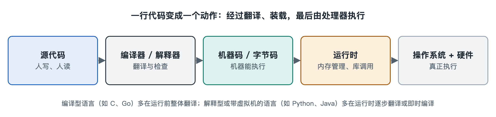

# 2.2 编译器、解释器与运行时：代码怎样变成动作

打开手机上的计算器，按下“7×8=”，屏幕立刻显示 56。写这个计算器的程序员当初敲下的是英文单词和符号拼成的文字，比如“result = a * b”。手机里的处理器并不认识这些文字，它只执行一串串由 0 和 1 组成的机器指令。从程序员写下的文字到处理器执行的指令，中间要经过一道转换。负责转换的主要有三类角色：编译器、解释器和运行时。本节逐一说明它们各自做什么，以及这些差别为什么会影响你手里应用的启动速度、安装包大小和更新方式。

## 2.2.1 处理器只懂一种“方言”

处理器，即中央处理器（Central Processing Unit，CPU），能直接执行的只有机器码（machine code）。机器码由很多条非常简单的指令组成，例如“把这个内存位置的数取到寄存器里”“把两个寄存器的数相加”“如果结果为零就跳到某处继续执行”。每一类处理器有自己的一套指令，这套规定叫指令集架构（Instruction Set Architecture，ISA）。写作时，个人电脑和服务器常见 x86-64 架构，手机和越来越多的笔记本电脑采用 ARM 架构。

同一份机器码不能在不同架构上通用。这一点后面会反复出现：程序“在哪台机器上跑”，会影响它“该怎样被翻译”。

源代码与机器码之间差得很远。源代码里一句“如果用户余额足够就扣款”，落到机器码上可能是几十条甚至上百条指令。从人能读懂的写法翻译成机器能执行的指令，大体有两条路线。

## 2.2.2 两种翻译方式：笔译与口译

可以拿翻译工作来打比方：

- **编译器（compiler）像笔译**。程序发布之前，编译器把整份源代码通读一遍，检查语法，做优化，一次性译成机器码，生成可执行文件。用户拿到的是“译好的书”，运行时不再需要源代码和编译器。C、C++、Go、Rust 通常走这条路。
- **解释器（interpreter）像同声传译**。程序运行时，解释器读一句，理解一句，执行一句。用户的设备上要装有解释器，程序以源代码或接近源代码的形式交付。早期的 JavaScript、Python 的常见用法属于这一类。

两条路线各有长短：

| 对比项 | 编译执行 | 解释执行 |
|---|---|---|
| 翻译时机 | 运行前一次完成 | 运行时边读边执行 |
| 运行速度 | 通常较快，翻译和优化已提前做完 | 通常较慢，翻译开销持续存在 |
| 错误发现 | 许多错误在编译阶段就会报出 | 往往执行到那一行才暴露 |
| 跨平台 | 每种架构、每种操作系统各编译一份 | 有解释器的地方就能运行 |
| 修改后见效 | 需要重新编译 | 改完即可运行，适合快速试验 |

编译阶段给出的报错，本质上是在程序交到用户手里之前拦下一部分错误。这也是不少大型项目偏爱带严格类型检查的语言的原因之一。类型检查会在编译时核对“这个变量该放数字还是文字”这类问题。

## 2.2.3 中间路线：字节码、虚拟机与即时编译

现实中很少有语言只走一条路。常见的折中做法是先编译成一种中间形式，再交给虚拟机去执行。

Java 是典型的例子。Java 源代码先被编译成字节码（bytecode）。字节码不属于任何一种真实处理器，是一套“通用中间语言”。执行时由 Java 虚拟机（Java Virtual Machine，JVM）读取字节码，再在当前机器上运行。同一份字节码可以在装了 JVM 的 Windows、Linux 或 macOS 上运行，这就是 Java 早年“一次编写，到处运行”这一宣传语的来由。C# 所依托的 .NET 平台也采用类似的结构。

只靠逐条解释字节码会慢，于是出现了即时编译（Just-In-Time compilation，JIT）。虚拟机在运行过程中统计哪些代码被反复执行，把这些“热点代码”现场编译成机器码，并缓存起来供后续调用直接使用。这好比一个口译员发现某段话总在重复，就提前写好译稿，之后照着念。浏览器中的 JavaScript 引擎普遍使用 JIT，例如 Chrome 采用的 V8 引擎和 Firefox 采用的 SpiderMonkey 引擎。今天的网页能流畅运行复杂的在线文档和地图，很大程度上依赖这项技术。

与 JIT 相对的是预先编译（Ahead-Of-Time compilation，AOT）。Android 系统的运行环境 ART（Android Runtime）在不同版本里结合使用了 AOT 和 JIT。其中一种常见做法是先让应用在 JIT 模式下运行，记录用户常用的代码路径，再在手机空闲充电时把这些路径预先编译好。具体策略随版本调整，这里的描述以写作时公开资料中的说法为准。苹果 iOS 上的原生应用则在开发者那一侧就编译成 ARM 机器码再上架。

所以，“编译型语言”“解释型语言”的说法只是粗略分类。更准确的问法是：这门语言的常见实现，在什么时候、以什么方式把代码翻译成机器指令？

## 2.2.4 运行时：程序身边的“后勤部门”

翻译完成后，程序还不能独立工作。它需要有人帮它申请内存、回收内存、处理出错、调度任务、调用系统功能。这一整套在程序运行期间提供支撑的组件，统称为运行时（runtime）。

运行时常见的职责有：

- **内存管理**：程序不断创建数据，用完的数据要回收。C 语言由程序员手动释放，忘记释放会造成内存泄漏，重复释放可能导致崩溃或安全漏洞。Java、Python、JavaScript、Go 等语言的运行时带有垃圾回收（Garbage Collection，GC）机制，自动找出不再使用的数据并回收。
- **异常处理**：程序遇到除以零、文件不存在等情况时，运行时负责把错误逐层报告上去，而不是让整个程序悄无声息地出错。
- **与操作系统打交道**：读文件、联网、显示画面，最终都要请操作系统代劳，运行时把这些请求包装成程序方便调用的形式。操作系统内部怎样完成这些工作，留给本系列《操作系统》一书展开。
- **线程与任务调度**：Go 的运行时会管理大量轻量级的并发任务，JavaScript 的运行时依靠“事件循环”安排异步操作。这部分内容在第六章讨论并发时还会遇到。

Node.js 是一个常被提到的例子。它把浏览器里的 V8 引擎拿出来，配上文件、网络等能力，让 JavaScript 可以在服务器上运行。语言没有变，换了一套运行时，同一种语言就能出现在完全不同的地方。

## 2.2.5 回到你的手机：这些差别你感受得到

上面这些概念，在日常使用里都有可以观察到的痕迹：

- 有些应用第一次启动明显偏慢，之后变快，可能与运行时的预热和即时编译有关。
- 网页应用不需要安装就能打开，原因在于浏览器里本来就带有 JavaScript 引擎和运行时。
- 同一款软件提供“Intel 芯片版”和“Apple 芯片版”两种下载，原因是编译产物绑定了处理器架构。
- 一些程序运行久了占用内存越来越多，可能是内存没有被正确释放，也可能是垃圾回收的策略在起作用。

把这一节压缩成一句话：源代码描述“要做什么”，编译器和解释器负责“翻译成机器能做的动作”，运行时负责“让这些动作在真实环境里持续、安全地进行”。不过，几乎没有哪个应用的每一行代码都由自己的团队编写。程序在被翻译、被运行的同时，还大量调用别人已经写好的代码。下一节就讨论这些库、框架与依赖。
