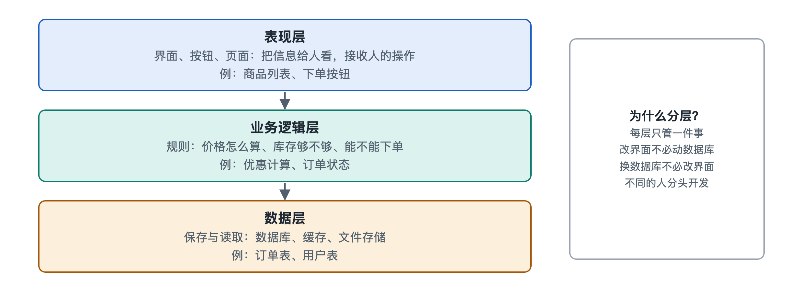

# 3.1 表现层：把信息呈现给人，接收人的操作

打开手机上的外卖应用，你看到的是一排排店铺图片、价格、评分和一个醒目的“去结算”按钮。你用手指往上一划，列表滚动；点一下“加一份”，数字从 1 变成 2，购物车图标轻轻一跳。这一切发生在你眼前的那块玻璃上，也正是软件系统中离人最近的一层——表现层（Presentation Layer）。它负责两件事：把信息变成人看得懂的样子，把人的动作变成系统听得懂的指令。

## 3.1.1 一块屏幕背后的“翻译官”

可以把表现层想象成餐厅里的服务员。厨房（业务逻辑和数据）里有菜品、库存和价格规则，但顾客不会走进厨房。服务员把菜单递给你，听你点菜，再把你的要求准确地转告厨房，最后把菜端上桌。服务员不决定一道菜怎么做，却决定你点菜时是否顺畅、是否容易出错。

对应到软件里，表现层的工作可以拆成一个循环：

1. **呈现**：把数据（例如“店铺名=某某面馆，评分=4.7”）排版成文字、图片、颜色和布局；
2. **接收**：捕捉点击、滑动、键盘输入、语音等操作，这类操作在工程上统称“事件”（Event）；
3. **转交**：把事件翻译成请求，交给业务逻辑去处理；
4. **刷新**：拿到处理结果后，更新屏幕上的相应部分。

这个“显示—操作—处理—再显示”的循环，每秒可能运行很多次。我们感到“流畅”，往往就是这个循环足够快、反馈足够及时。

## 3.1.2 界面是怎样“画”出来的

屏幕上的界面并不是一张整图，而是由许多小部件拼成的。按钮、文本框、图片、列表，在不同平台上叫法不同，常见的统称是“组件”或“控件”（Component / Widget）。它们像积木一样嵌套：一个页面里有一个列表，列表里有很多卡片，每张卡片里又有图片、标题和按钮。这种层层嵌套的结构在网页里叫文档对象模型（DOM，Document Object Model），在手机原生应用里一般叫视图层级（View Hierarchy）。

不同类型的应用，表现层的技术载体不一样，但结构思路相近：

| 应用形态 | 描述界面的常见方式 | 负责“画”出来的是谁 |
|---|---|---|
| 网页应用 | HTML 描述结构，CSS 描述样式，JavaScript 处理交互 | 浏览器 |
| 手机原生应用 | 平台提供的界面框架（写作时如苹果的 SwiftUI、谷歌的 Jetpack Compose） | 手机操作系统的图形系统 |
| 跨平台应用 | 一套代码描述界面，由框架适配到多个平台 | 框架自身或底层系统 |
| 桌面软件 | 系统界面库或内嵌网页技术 | 桌面操作系统 |

至于屏幕像素怎样被显卡点亮，属于操作系统和硬件的分工，本书点到为止。对应用开发者来说，更重要的是一个转变：近年主流界面框架大多采用“声明式”写法——开发者描述“数据是这样时，界面应该长这样”，数据一变，框架自动算出需要改动哪些部件，而不是由开发者一笔一笔地去改按钮上的数字。这种思路降低了界面和数据“对不上”的出错机会。

## 3.1.3 状态：界面为什么会“记得”

你在购物车里把份数改成 2，切到别的页面再切回来，它仍然是 2。这说明表现层需要保存一些“当下的情况”，工程上叫“状态”（State）：输入框里写了一半的地址、列表滚到了哪里、哪个选项被选中、页面是否正在加载。

状态分两类，区分清楚很重要：

- **界面状态**：只与展示有关，如弹窗是否打开、当前在第几个标签页，丢了也无妨；
- **业务数据的副本**：如购物车内容、账户余额，真正的“权威版本”在服务器上，表现层手里只是一份拷贝。

很多日常怪现象都出在这里。比如你在手机上已经付了款，另一台平板上的页面还显示“待支付”，就是那份拷贝没有及时更新。表现层要决定何时重新取数据、何时相信手里的副本，这也是后面章节讲缓存与一致性时的一个伏笔。

## 3.1.4 好的表现层：不只是好看

用户评价一个应用，常说“好用”或“难用”，这多半是表现层决定的。工程上有几条不容易过时的标准：

- **及时反馈**：点了按钮要立刻有反应，哪怕只是变灰或出现转圈。网络请求可能要几百毫秒甚至更久，有的应用会先把界面改成“预期结果”，失败了再撤回，这种做法常被称为“乐观更新”。
- **防止误操作**：表现层会在本地先做一轮基本检查，比如手机号位数不对就提示，避免无效请求发出去。但要注意，这只是为了体验，真正的规则检查必须在后端再做一遍，因为界面这一层可以被绕过——这一点在 3.4 节和第七章安全部分还会展开。
- **适配不同设备**：同一个页面要在小屏手机、大屏平板和电脑上都能正常显示，网页领域把这种能力称为“响应式设计”（Responsive Design）。
- **无障碍**：视障用户依靠“读屏”功能使用手机，前提是界面上的每个按钮都有可读出的文字说明。主流平台和网页标准都提供了相应规范，这既是体验问题，也是许多国家和地区的合规要求。
- **本地化**：文字长度、日期格式、货币符号、从右往左书写的语言，都会影响布局。

可以看出，表现层的难点不在“画得漂亮”，而在于在设备、网络、人群都千差万别的情况下，让信息始终清楚、操作始终可控。

## 3.1.5 小结：边界上的一层

表现层站在人与系统的交界处，它不掌握规则，也不保管权威数据，却决定了人能否顺利地把意图交给系统。它的核心结构是“组件树 + 状态 + 事件循环”，核心原则是“及时反馈、不越权、可适配”。下次你觉得某个应用“卡”或“别扭”，不妨分辨一下：是界面反馈慢了，还是后面的处理慢了？

而服务员转交给厨房的那张点菜单，接下来由谁来判断“这家店还营业吗、满减能不能叠加、库存够不够”？这正是下一节业务逻辑层要回答的问题。
