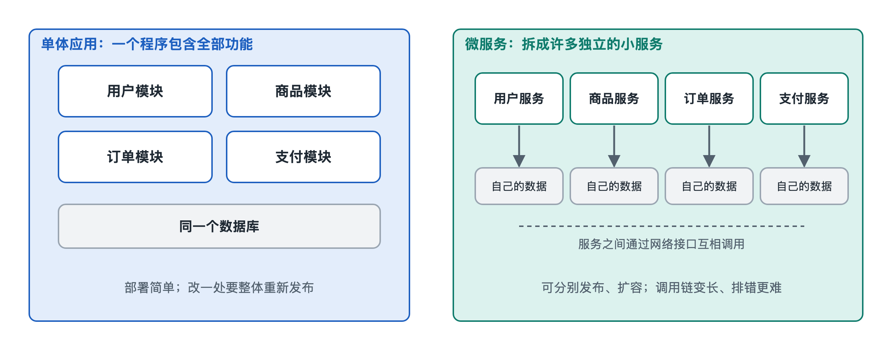

# 4.2 服务与服务：从单体应用到微服务

打开一个外卖应用，下一单午饭。屏幕上只是点了几下：选菜、付款、看骑手位置。但在服务器那一侧，这一单可能要经过“商品”“订单”“支付”“配送”“优惠券”“消息通知”等好几个部分的协作。这些部分是装在同一个程序里，还是分成几十个独立运行的小程序、彼此通过网络打招呼？这就是本节要讲的问题：服务端内部的各个部分怎样组织、怎样连接。

## 4.2.1 一个大程序：单体应用

最直观的做法，是把所有后端功能写在同一个代码库里，构建成一个整体，部署到服务器上运行。这种形态叫**单体应用**（Monolithic Application，常简称“单体”）。

可以把单体想象成一家小饭馆：老板兼厨师，点菜、炒菜、收钱都在一个屋檐下。好处很明显：

- **调用简单**：订单模块要查商品价格，直接调用同一程序里的一个函数，几乎不花时间，也不会“打不通”。
- **事务容易**：扣库存和生成订单可以放在同一个数据库操作里，要么都成功、要么都失败。
- **部署方便**：只有一个东西要打包、上线、监控。

很多成功的产品在早期都是单体，这并不是“落后”，而是在团队小、需求变化快的阶段最省力的选择。

问题出现在规模变大之后。代码越堆越多，几百名工程师改同一个代码库，改优惠券的人可能不小心碰坏支付；任何一处小修改都要把整个程序重新构建、重新发布；双十一时只有下单功能压力大，却只能把整个程序整体多部署几份，连很少有人用的后台报表模块也跟着复制。

## 4.2.2 拆成许多小服务：微服务

为了应对这些问题，业界逐渐形成了**微服务架构**（Microservices Architecture）：把一个大系统按业务能力拆成许多小的**服务**（Service），每个服务独立开发、独立部署、独立运行，通常还各自管理自己的数据，彼此之间通过网络接口通信。

回到饭馆的类比：单体是一个人包办一切的小店，微服务更像一座美食广场，面馆、饮品店、收银台各自营业，有自己的员工和库房，通过统一的取餐号码协作。“微服务”这一说法大约在 2010 年代前期流行开来，Martin Fowler 与 James Lewis 在 2014 年发表的文章是公开资料中常被引用的系统性描述。部分大型互联网公司（例如 Netflix、亚马逊）公开分享过从单体逐步拆分的经历，但它们的具体做法属于各自公司的实践，并非所有系统的标准答案。

两种形态的主要差别可以对照来看：

| 维度 | 单体应用 | 微服务 |
|---|---|---|
| 代码与部署 | 一个整体，一起发布 | 多个服务，各自发布 |
| 模块间调用 | 程序内函数调用，快且可靠 | 网络调用，有延迟、可能失败 |
| 数据 | 通常共用一个数据库 | 通常每个服务管理自己的数据 |
| 扩容 | 整体复制 | 哪个服务忙就只扩哪个 |
| 故障影响 | 一处崩溃可能拖垮整体 | 可隔离，但也可能连锁传播 |
| 团队组织 | 多人共改一个代码库 | 小团队各自负责若干服务 |
| 运维复杂度 | 较低 | 明显更高 |

## 4.2.3 服务之间怎样“说话”

一旦拆开，原本一行函数调用就变成了跨网络的对话。常见的通信方式有两类：

- **同步调用**：像打电话，一方发出请求，等对方回复后再继续。常用形式是基于 HTTP 的 REST 接口，或 gRPC（谷歌发起的开源远程过程调用框架）。下单时订单服务问商品服务“这件商品现在多少钱”，就属于这一类。
- **异步消息**：像发短信或留言，发出后不必等待。服务把一条“订单已支付”的消息放进**消息队列**（Message Queue），配送服务、积分服务、通知服务各自去取。即使通知服务暂时宕机，消息也会留在队列里，等它恢复后再处理。

服务一多，还需要一些“基础设施角色”来维持秩序：**服务注册与发现**让服务知道对方此刻在哪台机器上；**API 网关**（API Gateway）作为统一入口，把手机 App 发来的请求转给对应的服务；**熔断**机制在某个服务反复出错时暂时停止调用它，避免故障像多米诺骨牌一样扩散。这些机制在第七章讲云原生时还会展开。

## 4.2.4 拆分不是免费的

微服务解决了“大”的问题，却引入了“散”的问题。网络会延迟、会丢包；一个下单动作跨越五个服务，任何一环出错都要考虑怎么补救；原来一个数据库事务就能保证的“扣库存与生成订单同时成功”，如今要靠更复杂的手段协调，这正是第六章“事务与一致性”要讨论的难题；排查故障时，也要把散落在几十个服务里的日志串起来，才能还原一次请求的经过。

因此，业界常见的经验是：先把单体内部的模块边界划清楚，等到团队规模、发布频率或局部扩容需求真正成为瓶颈，再按业务边界逐步拆分。还有一种折中形态叫**模块化单体**，代码按模块严格隔离，但仍作为一个程序部署。另有公开报道显示，个别团队在拆分后又把部分服务合并回单体，原因正是运维成本超过了收益。

还有一条常被引用的经验叫**康威定律**（Conway's Law）：系统的结构往往会映射出构建它的组织的沟通结构。微服务之所以流行，部分原因就在于它让“一个小团队负责一个服务”成为可能。选择单体还是微服务，归根结底不只是技术问题，也是团队怎样分工协作的问题。

看清了服务与服务之间的关系，下一步要把视野再放大一圈：这些服务运行在什么之上？它们怎样依靠操作系统、云平台，又怎样通过应用商店走到你的手机里？这就是下一节的内容。
