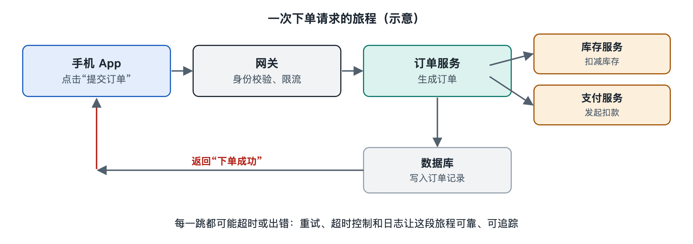

# 5.1 请求流：一次下单请求的完整旅程

在购物应用里选好一件商品，点下“提交订单”，屏幕转一两圈小圆圈，然后弹出“下单成功，请支付”。整个过程通常不到一秒。在这不到一秒里，你的手指发出了一个“请求”，它离开手机，穿过网络，进入一个由许多程序组成的后台系统，经过层层检查和处理，再带着一个“响应”回到你的屏幕上。

前几章我们分别认识了前端、后端、数据库、认证和微服务。本节换一个看法：不再一个零件一个零件地看，而是跟着一次请求走一遍，看它依次经过哪些部件、每一站做了什么、哪里可能卡住。

## 5.1.1 第一站：从手指到网络

请求的旅程从客户端开始。你点按钮的那一刻，App 或网页里的前端代码会做几件事：

1. **本地校验**：收货地址填了没有、数量是不是正数。明显的错误在这里就拦下，不必麻烦服务器。
2. **组装请求**：把商品编号、数量、地址编号等信息打包成一段结构化数据，常见格式是 JSON（JavaScript 对象表示法，一种用文字表示键和值的格式）。
3. **附上身份凭证**：把登录时拿到的令牌（token）放进请求头，告诉服务器“我是谁”。
4. **发送**：通过 HTTPS（安全超文本传输协议）发往某个地址，比如一个形如 `/api/orders` 的接口。

请求真正出发之前还要先找到目的地。域名需要通过 DNS（域名系统）解析成 IP 地址，再建立加密连接。这些步骤由操作系统和网络库完成，应用开发者一般不直接编写，但它们会占用一部分时间。网络差的时候“转圈圈”转得久，很多时间就花在这一段。

## 5.1.2 第二站：入口——负载均衡与网关

请求到达服务端，首先遇到的通常不是处理订单的程序，而是“门卫”。

- **负载均衡器**（Load Balancer）：一个大型应用往往同时运行着许多份相同的服务程序。负载均衡器把源源不断的请求分摊到这些副本上，避免某一台机器被压垮。
- **API 网关**（API Gateway）：统一的入口，负责验证令牌、限制单个用户的请求频率（限流）、记录访问日志，再根据路径把请求转交给后面对应的服务。

可以把网关想象成大楼前台：先核验访客证件，登记来访，再告诉你该去几楼几号房间。没有通过身份校验的请求，会在这里直接收到“401 未授权”之类的回复，根本进不了大楼。

## 5.1.3 第三站：业务处理——一个请求，多次协作

请求被转给“订单服务”之后，才进入真正的业务逻辑。以采用微服务架构的系统为例，订单服务往往要和其他服务协作：

| 步骤 | 向谁询问或通知 | 目的 |
|---|---|---|
| 查商品 | 商品服务 | 确认商品存在、未下架，取得当前价格 |
| 扣库存 | 库存服务 | 预留数量，防止超卖 |
| 算价格 | 优惠服务 | 计算满减、优惠券后的应付金额 |
| 写订单 | 订单数据库 | 把订单记录持久化保存 |
| 发通知 | 消息队列 | 告诉物流、积分等系统“有新订单了” |

这里有两种不同的协作方式。前四步通常是**同步调用**：订单服务必须拿到答案才能继续，就像打电话问完一件事才能办下一件。最后一步常用**异步消息**：把消息放进消息队列（Message Queue）就立刻返回，物流和积分系统稍后自己取走处理，就像在留言板上贴一张便条。用户等待的时间只包含同步部分，所以设计者会尽量把“不必马上完成”的工作挪到异步那一边。

不同公司拆分服务的方式差别很大，上表只是一种典型的划分示意。规模较小的系统，这些步骤可能都在同一个程序里完成，只是函数调用，不经过网络。

在这一站，缓存也常常出场。商品信息这类读得多、改得少的数据，订单服务可能先查内存里的缓存，命中了就不必访问数据库，能明显缩短耗时。

## 5.1.4 第四站：原路返回与“看不见的线索”

订单写入成功后，订单服务生成一个响应：订单号、应付金额、状态“待支付”，同样以 JSON 返回。响应沿着网关、负载均衡、网络一路回到你的手机，前端代码解析它，把界面从“提交中”切换到“请支付”页面。

一次请求可能穿过五六个服务，出了问题怎么查？许多系统会在请求进入入口时分配一个**追踪编号**（Trace ID），之后每经过一个服务都带着它，并把各自的处理时间记进日志。这种做法叫**分布式追踪**（Distributed Tracing）。工程师事后用这个编号就能把散落在各处的记录串成一条完整路径，看出“慢在库存服务”还是“错在优惠服务”。第三章讲的可观测性，在请求流上就体现为这条线索。

## 5.1.5 一次请求教给我们的事

跟完这趟旅程，可以归纳出请求流的几个基本特点：

- **分层把关**：客户端校验、网关鉴权、服务内部业务校验，每一层拦掉一类问题，越靠前拦截越省资源。
- **总耗时是各段之和**：网络传输、排队、每次同步调用、数据库读写都会累加。所以“页面慢”往往不是一处慢，而要逐段测量。
- **任何一站都可能失败**：网络中断、服务超时、库存不足。良好的系统会设置超时、重试和友好的错误提示，而不是让用户对着小圆圈无限等待。
- **重复提交要防住**：用户网络卡顿时可能连点两次。常见做法是给每次下单请求一个唯一标识，服务端发现重复就不再新建订单，这种性质叫**幂等**（Idempotency）。

请求流描述的是“一件事怎样被办完”。但订单写入数据库之后，数据本身还会继续旅行：被复制到备用数据库、同步给搜索系统、汇总进报表。下一节，我们就从请求流转向数据流，看数据怎样被写入、复制与读取。
