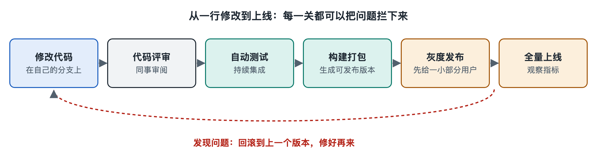

# 5.4 发布流：构建、灰度发布、回滚与应用更新

打开手机的应用商店，点进“更新”页面，你常会看到一排等待更新的应用，每个下面写着一句“修复了已知问题，提升了稳定性”。再留意一下：有时朋友的某个 App 已经出现了新按钮，你的却还是老样子，即使两人都是最新版本。这两个小现象背后，是同一条流水线，叫做**发布流**：一段已经合入主干的代码，怎样被打包、检验，再一步步送到亿万台设备和服务器上。上一节讲到代码“合入主干”就停下了，而合入并不等于用户能用上，中间还隔着构建、发布、观察和必要时的撤回。

## 5.4.1 从源代码到“可交付的包”：构建

代码合入后，第一步是**构建**（build）：把人写的源代码和它依赖的各种库，转换、组装成可以直接安装或运行的产物。对手机 App 来说，产物是一个安装包，例如安卓系统使用的 APK 或 AAB 格式文件、苹果系统使用的 IPA 文件。对服务端程序来说，产物常常是一个**容器镜像**（container image），它把程序和运行所需的环境封装在一起，第七章会细讲。

现代团队很少在某个工程师的电脑上手动构建，而是交给**持续集成**（Continuous Integration，CI）系统自动完成。每次合入都会触发一串固定步骤：

1. 拉取指定版本的源代码；
2. 下载并锁定依赖库的版本；
3. 编译、打包；
4. 运行自动化测试；
5. 给产物打上版本号并存入“制品仓库”。

这里有一个关键原则：**同一份产物一路走到底**。测试环境验证过的那个包，就是上线的那个包，不在中途重新编译。好比药厂检验合格的是哪一批药，出厂的就必须是那一批，不能检验完再另做一锅。这样才能保证“测过的”和“上线的”是同一个东西。

在构建之后自动推进到可发布状态，称为**持续交付**（Continuous Delivery，CD）；若连上线这一步也自动完成，常被称为持续部署（Continuous Deployment）。两者合称 CI/CD，是今天多数软件团队流水线的骨架。

## 5.4.2 不一次性推给所有人：灰度发布

拿到合格的包，最直接的做法是一次替换全部服务器。但测试环境再像真实环境，也模拟不了亿万用户五花八门的设备、网络和操作习惯。一旦新版本有隐藏问题，全量上线就意味着所有人同时遇到。

于是工程上普遍采用**灰度发布**：先让一小部分用户用新版本，观察没问题再逐步扩大。“灰度”取的是黑白之间渐变的意思。几种常见做法如下：

| 做法 | 怎么做 | 类比 |
|---|---|---|
| 金丝雀发布（canary release） | 先在少量服务器或少量用户上运行新版本 | 旧时矿工带金丝雀下井，鸟先出状况就赶紧撤 |
| 分批滚动发布（rolling update） | 一批一批替换服务器，每批之间检查健康状况 | 换高速路面，一次只封一条车道 |
| 蓝绿发布（blue-green deployment） | 准备一整套新环境，验证好后把流量一次切过去，旧环境保留待命 | 新舞台搭好彩排完，再把观众引过去 |
| 功能开关（feature flag） | 新代码已经上线，但功能默认关闭，通过配置给指定用户打开 | 灯装好了，开关握在手里 |

开头那个现象就有了解释：你和朋友的 App 版本相同，但服务端的功能开关只给他打开了新按钮。很多互联网公司还借助功能开关做对照实验（常称 A/B 测试），比较两种设计的效果。具体放量比例、每批间隔多久，各家公司做法不同，常见做法是从百分之一甚至更少起步，逐级扩大。

灰度能否发挥作用，取决于能不能**看得见**。第三章讲过的日志、监控和告警，在这里成为发布的“仪表盘”：错误率、响应时间、崩溃率一旦比旧版本明显变差，就该停下。

## 5.4.3 发现不对就撤回：回滚

**回滚**（rollback）指把系统退回到上一个已知正常的版本。它是发布流里的“后悔药”，也是团队敢于频繁发布的底气。

服务端回滚相对容易：旧版本的产物还在制品仓库里，重新部署即可；蓝绿发布更快，把流量切回旧环境就行；功能开关最快，关掉开关，代码不动。但有一类变化很难回滚，就是**数据**。如果新版本修改了数据库表结构，或者已经把新格式的数据写了进去，旧代码可能读不懂这些数据。所以工程上常把数据库变更拆成多步，保证新旧两个版本的代码在过渡期都能正常工作，即“向后兼容”。回滚能退回代码，却退不回已经发生的事情，这一点决定了发布方案必须事先设计，而不是出事再想。

## 5.4.4 手机上的更新：为什么不能说退就退

客户端应用的发布流，比服务端多了几道外部关口，见下表：

| 对比项 | 服务端程序 | 手机 App |
|---|---|---|
| 新版本由谁安装 | 团队自己部署到服务器 | 用户设备下载安装 |
| 上线前审核 | 团队内部流程 | 通常需经应用商店审核（写作时苹果 App Store 与主流安卓商店均有此流程） |
| 多版本并存 | 时间短 | 很长，总有用户不升级 |
| 回滚 | 可以直接换回旧版 | 难以把已装的新版收回，通常靠再发修复版或关闭功能开关 |

正因如此，手机 App 更依赖服务端控制。写作时，苹果和谷歌的应用商店都提供分阶段发布功能，可以先把新版本推给一部分用户。同时，App 的服务端接口往往还要兼容一段时间内的老版本，因为总有一部分用户迟迟不更新。你在更新说明里看到的那句“修复已知问题”，背后可能就是一次灰度中发现、再紧急补上的修复。

## 5.4.5 小结：发布是一种可控的风险

把这一节串起来，发布流就是一条“构建—验证—小范围放量—观察—扩大或撤回”的循环。它的目标不是保证永不出错，而是让错误被限制在少数人身上、在短时间里被发现、并能快速退回。发布越小、越频繁，每次变化就越容易看清和撤回，这是许多团队从“几个月发一次大版本”转向“一天发很多次”的原因。

不过，再谨慎的发布也拦不住所有问题。当监控曲线突然变红、用户开始抱怨打不开时，一次故障就开始了它的旅程。它怎样被发现、定位与修复，是下一节的主题。
