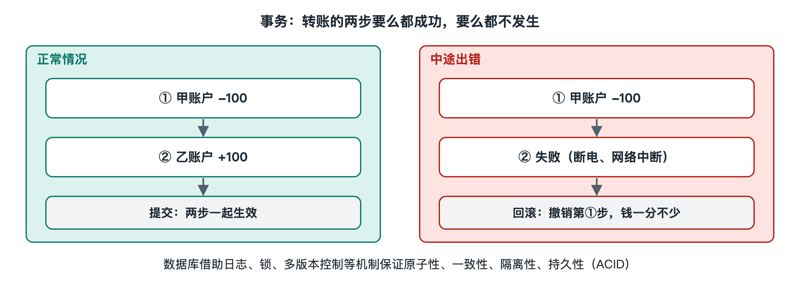

# 6.3 事务与一致性：转账为什么不会少一分钱

你在手机银行里给朋友转 500 元，按下“确认”的那一刻，信号突然断了。屏幕上转了几圈，最后显示“网络异常”。你心里一紧：钱扣了吗？朋友收到了吗？会不会出现“我这边少了 500，他那边没多”的情况？

几分钟后重新打开应用，结果只有两种：要么转账成功，你少 500、朋友多 500；要么转账没发生，双方余额都不变。“钱凭空消失”这种中间状态，正常运行的银行系统不会让它留下来。做到这一点的核心机制叫**事务**。

## 6.3.1 一笔转账其实是好几步

从软件角度看，“转账 500 元”至少包含两步写操作：

1. 把你账户的余额减去 500；
2. 把朋友账户的余额加上 500。

此外通常还要写一条流水记录，可能还要检查余额是否充足、是否超过当日限额。问题在于，这几步不可能在同一瞬间完成。如果第 1 步做完、第 2 步还没做，服务器恰好断电，或者程序出错崩溃，数据库里就会留下“钱扣了但没到账”的错误状态。

这就像搬家时把沙发从旧房子抬出来，还没抬进新房子，人就走了。沙发停在楼道里，不属于任何一边。

**事务（Transaction）**的作用，就是把这几步捆成一个整体，要么全部生效，要么全部不生效。在数据库里，程序先声明“开始事务”，执行一连串修改，最后要么“提交”（Commit），让所有修改一起生效；要么“回滚”（Rollback），把已做的修改全部撤销，回到开始之前的样子。

## 6.3.2 ACID：事务的四条承诺

数据库领域通常用四个英文首字母概括事务的保证，合称 **ACID**：

| 特性 | 英文 | 中文含义 | 在转账里的体现 |
|---|---|---|---|
| A | Atomicity | 原子性：全做或全不做 | 不会出现只扣钱不加钱 |
| C | Consistency | 一致性：数据始终满足规则 | 两人余额总和不变，余额不能为负 |
| I | Isolation | 隔离性：并发事务互不干扰 | 两笔同时进行的转账不会算乱 |
| D | Durability | 持久性：提交后就不会丢 | 显示“成功”后，即使断电也不丢失 |

这四条并不是自动出现的，背后各有具体机制支撑。

**原子性和持久性**主要靠“先记账，再动手”。很多数据库在真正修改数据之前，会先把“我准备做什么”写进一份按顺序追加的日志，常被称为**预写式日志（Write-Ahead Log，WAL）**。日志写到磁盘上之后，事务才算提交成功。万一中途崩溃，数据库重启时翻看日志：已提交的事务，按日志补做完整；没提交的，按日志撤销干净。这和会计“先记凭证再动账本”的做法很相似。

**一致性**一部分由数据库保证，比如设置“余额不能小于零”这样的约束；更大一部分来自业务逻辑本身，也就是第三章讲过的规则写进代码。数据库只能守住你告诉它的规则。

## 6.3.3 隔离：当两件事同时发生

上一节讲到，服务器会同时处理成千上万个请求。假设你账户里有 800 元，你在手机上给朋友转 500，同时家人用你绑定的卡在网上付了 500。两个请求几乎同时读到“余额 800”，都判断“够用”，各自扣掉 500 后写回“300”。结果花出去 1000 元，账上还剩 300。

这是一种典型的并发错误，常称为“丢失更新”。隔离性要解决的就是这类问题，常见做法有两类：

- **加锁**：一个事务要修改某个账户时先“锁住”它，别的事务只能排队等候。安全，但排队多了会变慢，还可能出现两个事务互相等对方放锁的**死锁（Deadlock）**，数据库需要发现并主动中止其中一个。
- **多版本并发控制（Multi-Version Concurrency Control，MVCC）**：数据保留多个版本，读的人看旧版本的“快照”，写的人生成新版本，读写之间尽量不互相阻塞。许多主流关系型数据库采用了这一思路。

完全隔离代价很高，所以数据库通常提供几个**隔离级别**，从宽松到严格，让开发者在性能与正确性之间选择。各数据库默认采用哪一级并不相同，这正是工程师需要查文档确认、不能想当然的地方。

## 6.3.4 跨越多个系统时：一致性更难

上面讲的都发生在一个数据库内部。可现实中的转账常常更复杂：跨行转账涉及两家银行的系统，网购下单要同时动订单服务、库存服务和支付服务。第四章提到，微服务架构下每个服务往往有自己的数据库，单个数据库的事务管不到别人家。

一种经典办法是**两阶段提交（Two-Phase Commit，2PC）**：由一个协调者先问所有参与者“你们都准备好了吗”，全部答应后再统一下令“提交”。它思路清楚，但协调者一旦出故障，参与者可能长时间卡住等待，因此在大规模互联网系统中用得较为谨慎。

另一类常见做法是放宽要求，接受**最终一致性（Eventual Consistency）**：允许短时间内各处数据不完全一致，但保证经过一段时间后会对齐。配套手段包括：

- **补偿操作**：某一步失败了，就执行一个反向动作抵消前面的步骤，比如退款、恢复库存。这种把长流程拆成多步、每步配有补偿的模式常被称为 **Saga**。
- **对账**：银行和支付机构普遍会定期核对双方流水，发现差异再人工或自动修正。
- **幂等性（Idempotency）**：同一个请求重复执行多次，结果和执行一次相同。回到开头断网的场景：如果你以为没成功又点了一次，系统会凭请求编号认出“这笔已经处理过”，不会扣你两次钱。

你在购物应用里见过“支付处理中，请稍候”“退款将在若干工作日内到账”这类提示，背后往往就是这些跨系统协调机制在工作。

## 6.3.5 小结：正确性是被设计出来的

“转账不会少一分钱”并不是计算机天生可靠的结果，而是工程师用日志、锁、版本、协调协议、补偿和对账一层层搭出来的保证。单个数据库内部，ACID 事务能提供很强的承诺；跨越多个服务和网络时，系统往往要在“强一致”和“快、可用”之间做取舍。这个取舍背后有深刻的理论限制，第八章讲 CAP 时会回到这里。

下一节我们换一个角度：当请求量大到一台服务器扛不住，系统靠缓存、负载均衡和弹性伸缩怎样撑住，而这些手段又会给一致性带来哪些新麻烦。
