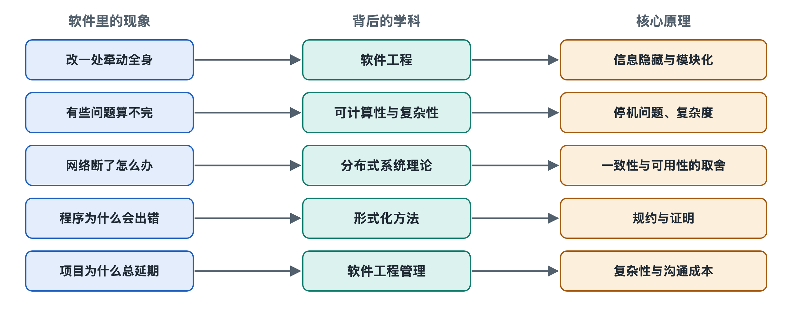

# 8.1 可计算性与算法复杂度：软件能做什么、做得多快

在手机通讯录的搜索框里输入一个名字，结果几乎是立刻跳出来的；可如果让导航软件在一座城市里找出“经过所有快递点、总路程最短”的送件路线，它往往只能给出一个“足够好”的答案，而不是保证最好的答案。同样是软件，为什么有的事一眨眼就做完，有的事却怎么也算不到“最优”？再往前追问一步：有没有一些事，无论机器多快、程序员多聪明，软件都根本做不到？

前面几章讲的是软件怎样被组织、连接和运行。从这一节开始，我们追问“为什么能这样工作”。第一个问题最根本：软件能力的边界在哪里，代价又是多少。

## 8.1.1 先有“能不能算”：图灵机与可计算性

二十世纪三十年代，还没有电子计算机，数学家们就在思考一个抽象的问题：什么叫“按照机械步骤解决问题”？英国数学家艾伦·图灵在1936年的论文中提出了一个极简的想象机器，后人称为**图灵机**（Turing Machine）：一条无限长的纸带、一个读写头、一张规则表，读写头每次读一个格子，按规则写入符号、左移或右移。

这台想象中的机器简单得近乎简陋，但一个被广泛接受的论断，即**丘奇—图灵论题**（Church–Turing Thesis）认为：凡是能用明确步骤机械完成的计算，图灵机都能完成。你手里的手机、云端的服务器，在“能算什么”这件事上，与图灵机等价，区别只在速度和内存。这个领域称为**可计算性理论**（Computability Theory）。

这带来一个直接的推论：不管用 Python 还是 Java，不管跑在手机还是超级计算机上，只要是通用编程语言，它们“能解决的问题集合”是一样的。第二章讲到的语言之争，争的是表达是否方便、运行是否高效，而不是谁能算出别人算不出的东西。

## 8.1.2 有些事永远算不出来：停机问题

图灵在同一篇论文里还证明了一件更惊人的事：存在一类问题，任何程序都无法解决。最著名的是**停机问题**（Halting Problem）：能否写一个程序，读入任意一段程序和它的输入，判断这段程序最终会停下来，还是会永远运行下去？

答案是不能。证明思路可以用一个小场景理解：假设真有一个“万能判官”程序。我们故意写一个“捣蛋鬼”程序，它先去问判官“我自己会不会停”，判官说“会停”，它就故意进入死循环；判官说“不会停”，它就立刻结束。无论判官怎么回答都是错的，所以这样的判官不可能存在。

这不是工程能力不足，而是数学上的界限。它直接影响你每天用的软件：

- 杀毒软件和代码扫描工具**不可能**做到“所有恶意行为都能查出、且从不误报”，只能在漏报与误报之间权衡；
- 编译器无法在一般情况下判断你的程序会不会卡死；
- 第六章讲的测试只能发现错误，无法在一般情况下证明程序没有错误。这一点会在8.5节形式化方法中再次出现。

所以工程师面对这类问题时的常见做法是：缩小问题范围、接受近似答案，或者设定超时。手机系统发现某个应用“长时间无响应”就弹窗询问是否关闭，本质上就是用一个时间上限代替“它到底会不会停”的判断。

## 8.1.3 能算出来，还要问多快：算法复杂度

能算的问题，速度也可能天差地别。衡量方法不是秒表，而是看**数据规模增大时，步骤数怎样增长**，这叫**算法复杂度**（Algorithmic Complexity），通常用**大O记号**（Big-O Notation）表示。

以查找为例。在一本乱序的通讯录里找人，只能一页页翻，一万个人最坏要翻一万次，这是 O(n)；如果通讯录按拼音排好序，就可以每次翻到中间、排除一半，一万人大约十几次就够，这是 O(log n)，即“二分查找”。数据库给表建**索引**（第二章提到的数据层），核心思想正是把“逐个翻”变成“按序快速定位”。

| 复杂度 | 通俗含义 | 日常例子 | 数据量从1千变到100万时 |
|---|---|---|---|
| O(1) | 一步到位 | 按编号直接取柜子里的包裹 | 几乎不变 |
| O(log n) | 每次排除一半 | 有序列表里二分查找 | 只多十来步 |
| O(n) | 逐个过一遍 | 统计一份名单的人数 | 约增1000倍 |
| O(n log n) | 高效排序 | 按时间给消息排序 | 增加约2000倍 |
| O(n²) | 两两比较 | 检查名单里是否有任意两人重名的笨办法 | 约增100万倍 |
| O(2ⁿ) | 尝试所有组合 | 穷举所有子集 | 规模稍大即不可行 |

这张表揭示了一个反直觉的事实：**硬件变快几倍，抵不过算法差一个级别**。一个 O(n²) 的写法在测试时数据只有几百条，跑得飞快；上线后数据涨到百万条，就可能拖垮整个服务。许多性能事故的根源不是机器不够，而是某处藏着一个增长过快的算法。

## 8.1.4 “难”问题与近似解：P 与 NP

回到开头的送件路线。这属于“旅行商问题”的一类变体，目前已知的精确算法在最坏情况下耗时随规模近乎指数增长。计算机科学把“能在多项式时间内求解”的问题称为 **P 类**；把“给出答案后能快速验证对错”的问题称为 **NP 类**。路线问题就是典型：给你一条路线，算它多长很快；但要找出最短的那条，目前没有已知的快速方法。

P 是否等于 NP，是计算机科学最著名的未解难题之一，被列为克雷数学研究所的“千禧年大奖难题”。主流看法倾向于认为两者不相等，但至今无人证明。

工程上的态度很务实：调度、排班、装箱、路径规划这类软件，普遍使用**启发式算法**或近似算法，在可接受时间内给出足够好的解。这也是为什么不同导航应用、不同时刻给出的路线可能不一样。

反过来，“难”有时恰恰是好事。第七章提到的密码与安全机制，依赖的正是某些问题（如大数分解）在已知方法下很难快速求解。软件安全的地基，部分就建立在“算得慢”之上。

## 8.1.5 小结：软件能力的两道边界

可计算性回答“能不能”：有些问题原则上无解，软件只能近似、限定范围或设置超时。复杂度回答“多快”：同样可解的问题，算法级别决定了系统能否承受规模增长。理解这两道边界，你就能明白为什么工程师总在追问“数据量多大”，为什么有些功能只能给出“推荐”而非“最优”。

不过，即便每个算法都足够快，一个由千万行代码组成的系统仍可能因为结构混乱而难以维护。下一节，我们从“怎么算”转向“怎么组织”，看信息隐藏与模块化原理如何让大型软件保持可控。
