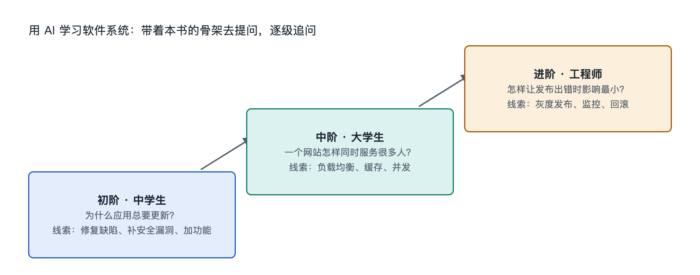

# 9.3 三阶提问阶梯：从中学生到工程师

打开手机里的外卖应用，点下“提交订单”，几秒后页面跳出“下单成功”。同样一个动作，三个人想问的问题完全不同：中学生好奇“它怎么知道我是谁”；刚学编程的大学生想知道“这个按钮背后调用了哪个接口”；后端工程师关心的是“晚高峰订单涌进来时，库存扣减会不会出错”。三个问题都对准同一个系统，只是落在认知阶梯的不同高度。

本节把向 AI 提问整理成三级台阶：**看见—拆开—推演**。每一级对应一种读者状态，也对应前面各章的一部分骨架。台阶的用处在于让你知道自己站在哪一级、下一步该迈向哪里，并不是要给人排座次。

## 9.3.1 第一阶：看见——用自己的话问“这是什么、在做什么”

第一阶的提问者不需要懂任何术语，只需要对手边的现象保持好奇。这一阶的目标是把一个模糊的“它就是能用”变成几个清楚的名词，对应本书第一章“认识对象”和第三章“功能解析”。

好问题有三个特征：从具体现象出发，说清楚自己看到了什么，请 AI 用类比解释。对照一下：

| 不太好的问法 | 更好的问法 |
|---|---|
| 软件是怎么运行的？ | 我关掉外卖 App 再打开，购物车里的东西还在，它存在手机上还是服务器上？ |
| 什么是数据库？ | 我在网页上改了昵称，换一台电脑登录也能看到新昵称，这个昵称被保存在哪里？请用生活中的东西打比方。 |
| 网络安全是什么？ | 为什么有的网站要我输验证码，有的不用？ |

左边的问题太大，AI 只能给出百科式的泛泛回答；右边的问题有一个可观察的现象做锚点，AI 的回答能和你的亲身经验对上。第一阶结束时，你应该能说出“客户端”“服务器”“数据库”“登录状态”这样的词，并知道它们大致指什么。

## 9.3.2 第二阶：拆开——问“由什么组成、怎样连接、怎样流动”

第二阶适合计算机专业入门者，也适合需要和软件团队沟通的产品经理、项目经理。这时你已经认识一些名词，提问的重点从“是什么”转向“各部分之间怎么配合”，对应第二章的结构拆解、第四章的连接关系和第五章的五种流动。

这一阶最有力的工具，是把第九章前两节的实物观察带进问题里。比如你在浏览器开发者工具（DevTools）的“网络”面板里看到一条请求，可以这样问：

> 我在开发者工具里看到点击“加入购物车”时发出了一个 POST 请求，地址里有 `/api/cart`，返回状态码 200，响应内容是一段 JSON。请帮我解释：这条请求从浏览器到服务器经过了哪些环节？POST 和 GET 有什么区别？JSON 是什么格式？

这个问题带有三样东西：**真实证据**（请求方式、地址、状态码）、**明确对象**（加入购物车这个动作）、**分点追问**。AI 的回答因此能落到可以核对的细节上。

第二阶常用的提问句式有：

- “请画出 A 到 B 的流程，标出每一步由哪个组件负责。”
- “这个功能如果拆成前端、后端、数据库三部分，各自承担什么？”
- “这段报错信息里，哪一行最可能指向问题所在？为什么？”
- “单体应用和微服务在这个场景下各有什么取舍？”

第二阶结束时，你应该能自己画出一张简单的架构草图，说清一次请求从点击到返回的大致路径。

## 9.3.3 第三阶：推演——问“为什么这样设计、出了问题会怎样”

第三阶面向有一定实践经验的开发者和工程师，对应第六章的机制、第七章的关键技术和第八章的原理。提问从描述系统转向推演系统：设想极端情况，比较设计方案，追问背后的约束。

例如：

> 假设一个秒杀活动中，同一件商品只剩 1 件库存，同时有大量用户点击购买。请分别分析：只在应用层先查询再扣减、使用数据库事务加行锁、使用缓存原子操作预扣库存，这三种做法各可能出现什么问题？请结合事务隔离和并发的知识说明，并指出哪些结论依赖具体数据库的实现。

这个问题有几个第三阶的标志：设定了**边界条件**（库存为 1、高并发）；要求**比较多个方案**而不是要一个“标准答案”；主动请 AI **区分通用原理和特定产品的做法**。最后一点很重要，不同数据库在锁和隔离级别上的默认行为并不相同，AI 很容易把某一种实现说成普遍规律。

第三阶还有一类“反向提问”值得练习：把自己的设计交给 AI，请它扮演挑剔的评审者，比如“请找出这个方案在网络分区时可能出现的三个问题”。这类提问把 AI 当作陪练，不把它当作权威。

## 9.3.4 每一阶都要做的三件事

无论站在哪一级，下面三个习惯都能减少被 AI 误导的风险：

1. **给出上下文**：说明你的身份、已经知道什么、在用什么设备或系统。同一个问题，“我是高中生”和“我在维护一个线上服务”应当得到不同深度的回答。
2. **要求可核实的依据**：请 AI 说明哪些内容来自公认原理，哪些是推测；涉及具体产品时，要求它注明“这是某某系统在某个版本中的做法”。随后用官方文档、开发者工具或一次小实验去验证。
3. **把回答落回骨架**：读完回答后问自己，这属于九层阶梯中的哪一层？它和前面学过的哪个概念相连？只有放进骨架的知识，才不会读过就散。

还要记住，AI 生成的代码和解释都可能出错，在第三阶尤其如此。工程师对 AI 的回答负有核验责任，生产环境里的结论需要测试和评审来确认。

## 9.3.5 台阶可以往上走，也可以往下走

三阶台阶不是一次走完的单行道。工程师遇到陌生领域，比如第一次接触形式化验证，同样要回到第一阶，用自己的话问“这到底在证明什么”；中学生只要带着一份真实的报错截图，也能问出第二阶的问题。判断自己在哪一阶，不看身份，看你对眼前这个问题掌握了多少证据、理解到哪一层结构。

书给出骨架，手边的应用提供现场，AI 负责沿着你的问题继续展开。下一节将对第九章做骨架小结，并把三阶提问落实为可以立刻动手的探索任务。
