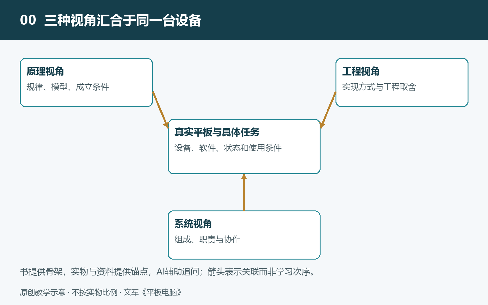

# 0.1 从八系列62册到本书：以平板电脑为入口认识系统

拿起一台平板电脑，你可能先看见正在播放的视频、一页教材，或刚写下的笔记。屏幕背后的计算、电池中的储能、笔尖动作的识别，通常不会进入注意范围。然而，一次看似简单的书写，已经让多个部件与软件共同参与。理解平板电脑，不只是知道它有哪些功能，还要看清这些功能怎样成为可能。

## 0.1.1 从身边对象进入技术世界

本书属于规划为八个系列、共62册的系统知识通识读物，是第一系列第03册。这套丛书以具体对象为入口，帮助读者把日常经验与科学原理、工程设计连接起来。每册围绕一个对象展开，也为跨对象理解留下线索：认识一台设备中的供电、感知和控制，有助于以后辨认其他系统中的相似关系。

“系统”并不神秘。它指的是一些相互联系、共同完成任务的部分所构成的整体。平板电脑的屏幕、电池和芯片不是简单装进同一个外壳就能工作；它们需要合适的连接、供电和软件协调。系统知识所关心的，正是这些部分如何组成整体，以及整体为什么表现出某种能力和限制。

你不必按丛书顺序阅读，也不需要先掌握工程学。本书从可以观察的现象出发，遇到必要概念时再解释，让问题带着知识逐步展开。

## 0.1.2 为什么选择平板电脑

平板电脑适合充当观察系统的窗口，因为它把显示、触控、手写、计算和移动供电集中在一件常见物品中。手指滑动后页面移动，笔尖经过后留下墨迹，接上电源后电量变化，这些熟悉的动作都能成为追问的起点。

例如，笔迹跟不上笔尖，原因未必只是“芯片不够快”。笔的位置需要被感知，数据需要被处理，应用需要生成线条，屏幕还要在合适的时刻显示结果。任何一个环节的等待，都可能影响体验。同样，电池容量较大也不必然意味着续航更长，还要看屏幕、计算任务及其他部分消耗多少能量。

这些例子提醒我们：单个参数可以描述一个侧面，却不能代替对整条工作链路的理解。

## 0.1.3 从功能表走向关系图

本书不以操作教程、性能排名或维修步骤为主线，而是尝试建立一张系统知识地图。我们既要认识组成部分，也要追踪它们之间的关系：谁向谁提供信息，谁为谁供应能量，哪些条件会限制最终效果。

这种观察会改变提问方式。面对轻薄机身，不只问“厚度是多少”，还要问内部空间怎样分配；面对明亮屏幕，不只问“亮度有多高”，还要问测试条件、耗电和发热；面对磁吸配件，则要区分固定、通信与充电，不能把“能吸住”直接当成“能传电”的证据。

不同产品的答案可能不同。主板位置、电池形状、显示技术和手写方案，都需要结合具体机型核实。通用原理帮助我们提出问题，产品资料帮助我们确定边界。

## 0.1.4 带着问题，而不是结论阅读

接下来的九章将依次讨论对象、结构、功能、连接、流动、机制、关键技术、基础原理与AI协同。这九层是本书组织内容的框架，不是必须严格遵守的学习次序。你可以顺着阅读，也可以从一次真实使用中的疑问进入，再回到相关章节补足背景。

观察始终以安全为前提：不必拆开设备，更不需要弯折机身或试探电池。外部现象、官方资料与可靠拆解记录，已经能够支持许多有价值的追问。读完本书，重要的不是记住所有器件名称，而是看到一块数字玻璃时，能够辨认其背后的协作关系，并知道哪些解释已有依据，哪些还需要核查。
