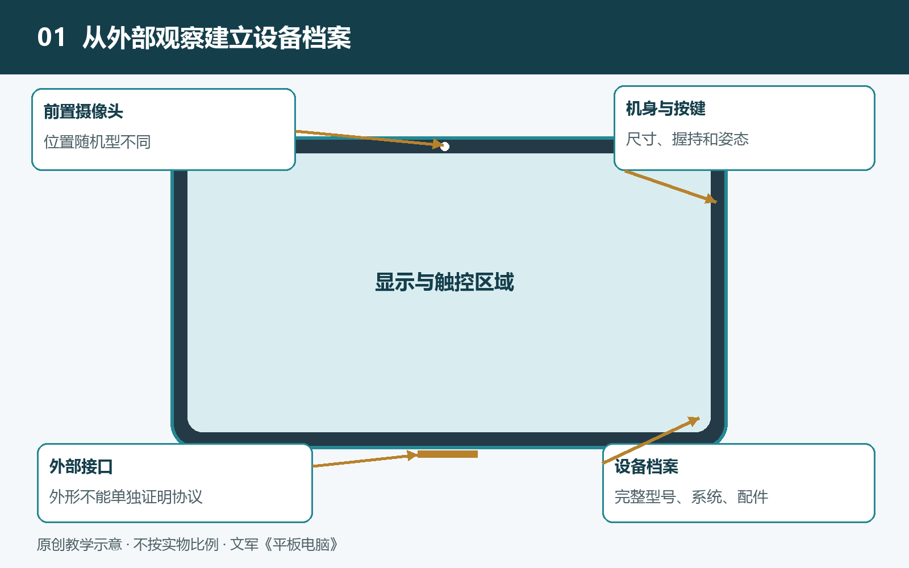

# 1.1 从外形到用途：认识手中的平板电脑

把一台平板电脑放在桌上，先不打开应用，也不查看参数。你能直接看到什么？正面是一块占据机身主要面积的屏幕，四周留有边框；侧边分布着按键、接口和一些小孔；背面可能有摄像头，某些位置还能连接保护套、键盘或手写笔。这些熟悉的外观不是装饰的集合，而是理解整台设备的入口。

认识平板电脑，可以先抓住一个特点：它把屏幕、计算部件、电池和主要输入方式装进同一块便于移动的板状机身，让人直接在显示内容的位置进行操作。

## 1.1.1 从一块屏幕认识整台设备

平板电脑的正面既是输出窗口，也是输入区域。屏幕显示文字、图像和视频，触控系统则感知手指的位置与动作。两者看起来重合，承担的工作却不同：显示负责“让你看见”，触控负责“知道你碰了哪里”。支持配套手写笔的设备，还需要相应的感应与处理能力，并非任何屏幕都能识别所有手写笔。

这种输入与显示位置重合的方式，称为直接交互。你想放大一张地图，就在地图上张开两根手指；想给一句话加批注，就把笔尖移到那句话旁边。与鼠标控制远处指针相比，它减少了操作位置与目标位置之间的分离，但也带来新的问题：手指可能挡住内容，手掌可能接触屏幕，细小按钮不一定容易点准。因此，平板应用中的按钮大小、菜单位置和手势设计，都要适应人的手与屏幕之间的关系。

从这里已经可以看出，平板不是“屏幕加上一些零件”那么简单。外形决定了交互条件，软件必须回应这些条件，才能形成完整的使用体验。

## 1.1.2 外观上的线索，各自说明什么

沿着机身边缘观察，通常能找到电源键和音量键。它们让人在屏幕关闭或触控不方便时，仍能发出基本指令。有些设备还把指纹识别部件与按键结合，不过不能仅凭按键形状判断它是否具备这一功能。

机身上的孔洞也各有用途。成组开孔可能对应扬声器，较小的孔可能与麦克风有关，但外观只能提供线索，准确用途应对照该型号的使用说明。不要把针或其他物品插入不明孔洞，也不要通过堵孔、刮擦等方式试探内部结构。

接口是设备与外部世界交换电能和信息的位置。外形相同的接口，支持的充电、数据传输或视频输出能力可能不同；看到一个接口，并不等于已经知道它能连接哪些设备。类似地，背面或侧边的金属触点可能服务于专用配件，但它们的用途需要资料确认。

摄像头的位置同样值得注意。平板既可能竖着用于阅读，也可能横着放在支架上视频通话，摄像头处于哪一侧，会影响视线方向和握持遮挡。观察这些细节，不是为了给外观打分，而是理解设计者怎样安排不同任务的入口。

## 1.1.3 它与手机、笔记本有什么不同

把平板称为“放大的手机”，能说明两者都常用触控，却容易忽略屏幕面积改变之后的操作方式。阅读整页资料、并排查看内容、绘制草图，都需要可用的显示空间。屏幕变大后，界面也不能只是把手机上的按钮等比例放大，还需要重新安排信息。

把平板称为“去掉键盘的笔记本”，则容易忽略它原本就围绕屏幕直接操作而设计。笔记本通常依靠键盘和指针设备完成主要输入，屏幕与底座之间有相对稳定的位置关系；平板则可以拿起、旋转、平放或架起。它的姿态更灵活，但长时间打字往往需要额外支撑和输入配件。

这些区别不是绝对边界。有些笔记本支持触控和手写，有些平板也能连接键盘、鼠标或外接显示器。与其只按外形分类，不如追问：这台设备主要怎样输入？使用时怎样支撑？操作系统和应用允许完成哪些任务？这些问题更接近它的实际能力。

## 1.1.4 用一个任务串起整个系统

设想你正在阅读一份课程资料，并用手写笔圈出重点。眼前只是一个简单动作，背后却有多个部分协作：存储部件保存文件，计算部件运行阅读应用，显示系统呈现页面，手写感应系统接收笔尖动作，软件再把动作转换为可保存的批注。电池和供电电路则为这些工作持续提供能量。

如果随后开启视频通话，摄像头、麦克风、扬声器和网络连接也会加入。平板的用途并非由某一个“最强零件”单独决定，而是取决于这些部分能否围绕任务协同，以及应用是否提供所需功能。

因此，“能打开文件”与“能顺利完成工作”并不是一回事。完成任务还可能涉及编辑权限、文件格式、配件兼容和结果导出。认识设备，需要把外观、内部功能与实际用途连在一起。

不妨选一个自己常做的任务，记录使用时的姿态、输入方式和所需配件，再对照说明书确认相关接口与功能。无需拆开机身，你已经开始从“这是一块屏幕”，走向“这是一套围绕人的操作组织起来的计算系统”。
