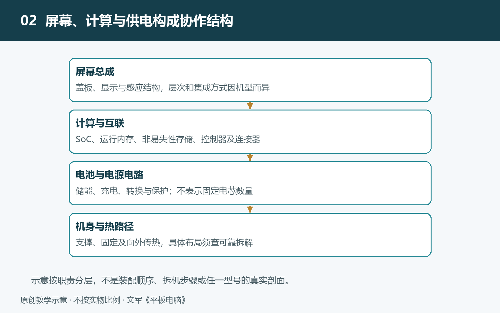

# 2.1 从可靠拆解资料认识内部布局：共性与机型差异

平板电脑的外观像一块完整的薄板，内部却不是把零件随意铺平。屏幕、电池、主板和扬声器都要占据空间，还要为连接、固定和散热留出位置。认识这些安排，不必亲手拆机。借助来源清楚的拆解照片、维修手册与结构说明，我们就能初步理解：同样是一块大屏幕，背后为什么会有不同的布局。

## 2.1.1 先确认资料展示的是哪一台设备

阅读拆解资料，第一步不是找芯片，而是确认设备身份。产品名称相近，不代表内部相同；同一系列的不同尺寸、代际，以及无线局域网版和蜂窝网络版，都可能采用不同的主板或天线安排。应尽量记录完整型号、发布时间和版本，而不只写“某品牌平板”。

资料来源也有层次。厂商公开的维修手册适合核对部件名称和装配关系；有连续拆解过程、清晰原图及型号说明的专业维修或拆解资料，适合观察内部位置。只有一张裁剪图片、没有出处的转帖，可以提供线索，却不宜承担关键结论。即使资料可靠，也要留意它展示的是零售产品、工程样机，还是更换过部件的维修设备。

照片还存在观察方向的问题。有的设备从屏幕一侧打开，有的从后盖一侧进入；两张图中的“左边”，未必对应机身的同一侧。可以先用摄像头、充电接口和按键作为定位标记，再判断部件位置。否则，图像的翻转就可能被误认成布局差异。

## 2.1.2 先看空间分区，再看细小器件

面对密集的内部照片，先辨认几个大区域，比立即追认每颗芯片更有效。电池通常表现为较大的扁平封装；主板是承载芯片和电路的板件，有时被金属屏蔽罩遮住；扬声器模组常靠近出声孔；摄像头则可通过镜头位置与外观对应。它们之间还能看到带状的柔性连接件，也就是常说的软排线。

这些外观特征只是识别入口，不是最终证据。黑色覆盖层可能用于绝缘、导热或遮蔽，不能一概认作电池；金属罩下也可能包含多种电路。遇到不确定的区域，应写成“疑似主板区域”或“用途待核实”，再与维修手册和其他角度的照片对照。

还要区分“看见了什么”与“设备包含什么”。照片中没有出现某个模块，可能是它被覆盖、位于背面，或已经在前一步拆除。尤其是屏幕总成，其显示、触控及手写感应相关结构可能相互集成，仅凭机身打开后的俯视图，往往无法完整判断层次。

## 2.1.3 共性是空间协调，不是固定模板

平板内部的共性，在于多个模块共同争用有限空间。屏幕覆盖正面的大部分面积，电池需要一定体积储存能量，主板需要容纳计算与通信电路，扬声器需要声学空间，边缘还要安排接口、按键和天线。这些需求共同限制了零件的位置。

但这些限制不会导出唯一布局。主板可以靠近一侧，也可以呈长条形或不规则形状；电池可能由一个或多个电芯构成，其外形要适应周围部件。照片上看到两块电池区域，并不能直接判断它们怎样串联或并联，更不能仅凭面积推算容量。

“中央主板、两侧电池”可以作为一种布局示意，却不能当作所有平板的标准答案。主板居中也不等于它就是承力骨架：电路板主要承担电气功能，整机刚性还取决于外壳、中框、支撑件及其连接方式。同样，电池左右对称并非实现合理重心的唯一途径，其他部件的质量与位置也会影响握持感。

因此，观察布局时更有价值的问题是：哪些部件彼此靠近？哪些部件被分开？连接路径经过哪里？这些问题比“它是否符合某张标准图”更接近真实工程。

## 2.1.4 用多种约束解释机型差异

为什么两台外形接近的平板，内部安排却不同？可以先从需求差异寻找解释。支持蜂窝通信的版本需要增加或调整相关电路与天线；摄像头数量、扬声器配置、配件连接方式不同，也会改变可用空间。机身尺寸与厚度变化，则可能迫使主板、电池和连接件重新安排。

散热是另一项约束，但不能把所有位置差异都归因于散热。发热器件需要通过导热材料与结构把热量向外传递，实际效果取决于整条路径，而不只是芯片离手掌远不远。照片中的深色薄片也不能仅凭颜色就认定为石墨，更不能直接称为石墨烯。

维修与装配同样影响布局。某个接口独立安装在小电路板上，可能方便更换，但也增加连接环节；某根排线绕过电池，可能与装配顺序或空间避让有关。若没有设计说明，这些只能列为合理解释，不能写成厂商已经证实的设计意图。看懂系统，既要提出原因，也要保留其他可能。

## 2.1.5 完成一次不拆机的布局对照

选择与你设备型号一致的一组可靠拆解资料，记录来源、版本和观察方向。在照片副本上标出电池、主板、扬声器、摄像头及主要排线，只标能确认的部分，不必追求填满整张图。

再选另一台平板的资料，比较三件事：大模块的位置是否相同，连接路径是否不同，哪些区域仍被遮挡。把记录分成“照片直接可见”“资料明确说明”“仍需核实”三栏，就能避免把猜测悄悄变成事实。整个任务只需查阅资料，无须揭屏、探测电池或按压机身。

内部布局图首先是一张空间地图。它告诉我们模块在哪里，却还没有解释每个模块内部怎样工作。带着这张有证据边界的地图，再去认识主板、芯片与存储器，细节才有可以安放的位置。

## 2.1.6 真实资料示例：先把结论限制在型号之内

Apple在2024年5月7日介绍M4版iPad Pro时，分别给出11英寸机型5.3毫米、13英寸机型5.1毫米的厚度，并说明该代两种尺寸采用串联OLED显示技术。[R1] 这提供了一个有型号与日期边界的实例，不支持“所有平板都不足6毫米”或“所有平板均用OLED”的说法。读者可把设备完整名称与年份写入档案，再对照自己的型号，而不是只凭正面外观归类。
