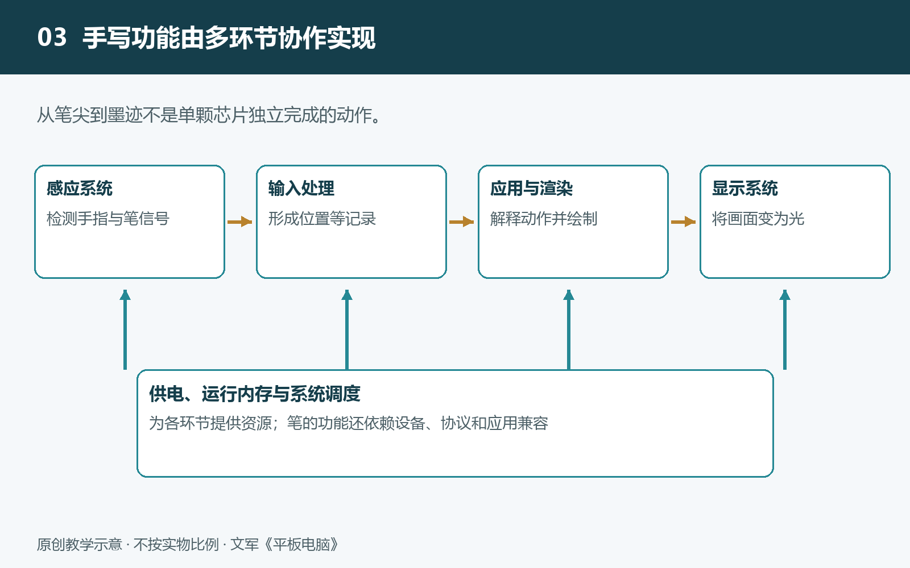

# 3.1 计算与存储：执行任务、暂存数据和保存文件

在平板上打开课本、播放讲解视频，再用手写笔做批注，看起来只是几个简单动作，背后却有三类工作同时进行：执行指令，把正在使用的数据放在便于处理的位置，以及把需要保留的成果写入长期存储。理解这三类工作，就能分清处理器、运行内存和存储空间的职责，也能解释为什么“文件放得下”并不等于“应用运行得顺”。

## 3.1.1 计算：把操作要求变成处理结果

平板收到一次操作后，并不是由某个芯片独自完成全部任务。应用程序先按照既定规则提出处理要求，操作系统再组织硬件执行。例如，打开一份带插图的课本，需要读取文件、解释文档格式、安排文字与图片的位置，最后生成可以显示的画面。

中央处理器，简称CPU，主要负责执行程序指令、判断条件和组织任务。它像一位按步骤办事的协调者，但不只是“发号施令”：文档解析、应用逻辑和许多通用计算，也由它直接承担。处理器常有多个核心，可以分别推进任务，不过核心更多并不保证每项工作都更快。任务能否拆分、软件怎样安排，以及持续运行时的供电和温度条件，都会影响结果。

图形处理器，简称GPU，擅长并行处理大量相似的计算。绘制应用界面、合成图层、生成游戏画面，都可能用到它。这里的“并行”，是指让多个计算单元同时处理不同部分，而不是把所有工作排成一条长队。GPU也能用于部分非图形计算，但需要软件支持，不能代替CPU包办全部任务。

许多平板还集成视频编解码、图像处理或神经网络计算等专用单元。它们针对特定任务设计，可能用较少的能量完成相应处理。例如，播放受支持格式的视频时，专用解码单元可以承担主要解码工作；若格式或参数超出支持范围，则可能改由其他单元处理。所谓“芯片支持”，必须与实际文件、应用和系统版本一起判断。

## 3.1.2 运行内存：为正在进行的工作提供周转空间

计算需要随时取用指令和数据。运行内存，通常简称内存或RAM，就是系统放置当前工作内容的重要空间。正在阅读的页面、编辑中的笔记、解码后的视频画面，以及应用自身的一部分程序，都可能占用它。

可以把内存理解为工作台：台面较大，通常更容易同时展开多项工作；但台面本身不会替你完成计算。内存容量增加，主要改变的是可容纳的工作规模，不能直接等同于处理器速度提高。内存传送数据的能力，也会影响某些任务的表现。

当多个应用争用内存时，操作系统会进行管理。它可能回收可以重新生成的数据、压缩部分内容，或结束后台应用的进程。有些系统还会借用部分存储空间辅助周转，但具体方式因平台而异，不能把它看成与物理内存完全相同的扩容。

因此，从视频应用切回笔记应用时，若笔记仍停在原处，说明系统保留或恢复了相关状态；若出现启动画面，则可能发生了重新加载。不过，仅凭一次重新加载，不能断定内存不足，应用设计、系统策略和程序异常也可能造成类似现象。

## 3.1.3 存储空间：让文件在关机后仍然存在

照片、课本、应用程序和保存后的笔记，主要保存在非易失性存储中。“非易失性”是指正常断电后仍能保留数据，平板通常使用闪存实现这一功能。它与运行内存的重要区别，不是一个“会计算”、另一个“不会计算”，而是保存特性、访问速度和承担的工作不同。

安装应用时，程序文件先进入存储空间；启动后，系统把需要的部分调入内存，供处理器使用。编辑笔记时，正在变化的内容可能先处于内存中，随后由应用自动或手动写入存储。屏幕上已经出现文字，并不必然说明文件已经完整保存。

“保存到本机”和“同步到云端”也是两件事。前者把数据写入设备，后者还涉及网络、账户和远端服务。离线时仍能编辑，不代表修改已经上传；文件列表中出现名称，也不保证全部内容已经下载。重要作业应核查保存与同步状态，并保留独立备份。

## 3.1.4 用一次批注任务看清三者配合

假设你打开一份课本，在插图旁写下说明，再导出带批注的文件。原始课本先从存储空间被读取，相关页面数据进入内存；CPU处理文档规则和操作逻辑，GPU参与画面绘制。写字过程中，应用根据收到的输入更新笔迹，内存容纳正在编辑的状态；保存或导出时，计算单元整理内容，再把结果写入存储。

这条链路说明，等待不一定来自同一个环节。复杂页面打开慢，可能涉及读取、解析或绘制；多应用切换后反复加载，可能与内存管理有关；导出大文件耗时，则可能同时受计算和写入速度影响。不能仅凭“卡了一下”就判定某颗芯片性能不足。

计算、内存和存储构成了一组相互依赖的分工：计算负责处理，内存负责周转，存储负责保留。认识这组关系之后，再观察触控、手写和显示，就能进一步分清：哪些模块负责获取或呈现信息，哪些模块负责在中间把信息变成有用的结果。
