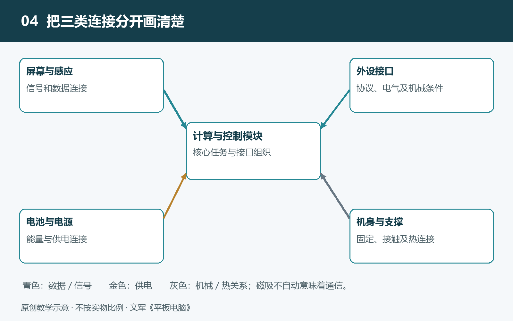

# 4.1 机身与支撑结构：轻薄、刚性和内部空间如何兼顾

把平板电脑平放在桌面上，它像一块完整的薄板；拿起来阅读时，它又要支撑屏幕、电池和电路，并承受握持、支架接触与日常搬运带来的载荷。这里的“载荷”，就是作用在结构上的力。机身设计要解决的，不只是把零件装进去，还要让这些力沿着可靠的路径传递，避免局部过度变形。

轻薄、坚固与宽裕的内部空间并不能同时无限增加。理解这种折中，需要从材料、形状和连接方式三个方面观察。

## 4.1.1 刚度不等于强度，轻薄也不只看总厚度

评价机身时，先要区分两个容易混用的词。刚度表示结构抵抗变形的能力：同样的力作用下，变形越小，刚度越大。强度则关注材料或结构在多大载荷下会发生屈服、断裂等失效。屈服意味着撤去外力后，变形也不能完全恢复。因此，“不容易弯”和“弯了不容易坏”不是同一个判断。

材料的弹性模量可以帮助描述它在弹性范围内抵抗变形的能力。不同牌号、不同热处理状态的铝合金，强度可能相差明显，但弹性模量通常不会随强度同比增加。因而，换用强度更高的铝合金，不等于相同形状的机壳就会明显更难弯曲。

产品标示的整机厚度，也不能直接当成承力金属板的厚度。屏幕、胶层、电池和装配间隙都占据厚度空间。两台外观同样薄的设备，可能采用不同的边框截面、内部支架和固定方式，结构表现不能仅凭一个尺寸判断。

## 4.1.2 薄板模型解释趋势，不替整机作结论

为什么减薄结构常常让工程师格外谨慎？一个简化模型能说明原因：对于均匀、各向同性、等厚的薄板，在小挠度弹性弯曲条件下，其抗弯刚度与材料弹性模量有关，并与厚度的三次方成正比。“小挠度”指变形足够小，可以使用相应的线性近似。

如果材料、板面尺寸和支撑条件等保持不变，把这块理想薄板的厚度减到原来的八成，其抗弯刚度约为原来的百分之五十一。这个计算说明的是：在这些假设下，减薄的影响可能比直觉更显著。

但真实平板电脑不是一张均匀金属片。它有侧壁、开孔、台阶、支架，也有玻璃及不同性质的连接层。受力位置、支撑跨度和载荷方向都会改变结果。不能把整机标称厚度代入立方关系，就宣布某款产品的“耐弯能力下降一半”。真实结构需要结合具体设计，通过计算分析和规定条件下的试验评价，而不是让读者动手弯折验证。

## 4.1.3 用截面形状，把有限材料放到合适位置

提高刚度并不只有增加整块背板厚度这一条路。想想平整纸片与折出侧边的纸片：即使材料没有增加，截面形状改变后，抵抗某些方向弯曲的能力也会改变。平板机身同样可以利用边框侧壁、局部凸台或加强筋，让材料更有效地参与承力。

描述这种效果时，工程上常用“截面二次矩”：它反映截面材料相对弯曲中性轴的分布。中性轴附近的材料在弯曲时伸缩较小，离它较远的材料通常更能帮助抵抗弯曲。不过，怎样布置才有效，仍取决于受力方向和结构连接，不能认为任何凸起都是加强筋。

一些设备采用一体化金属壳体，使背板与侧框连续连接，减少部分拼接界面；另一些采用独立中框、后盖和支架组合。数控加工可以形成安装台阶、螺钉座和局部加强结构，但不能据此认定所有机壳都由整块金属完全铣削而成，也不能从外观推断内部必有工字形筋条。

接口、扬声器孔和天线区域还会打断结构连续性。这些位置既要满足功能，又要控制局部应力集中，因此常需要在周边形状和固定方式上补偿，而不是简单地“越少开孔越好”。

## 4.1.4 内部空间也是一张受力关系图

机身内部每增加一处支撑，就可能挤占电池、扬声器或电路空间；每减少一处支撑，又可能增加局部变形。设计者需要同时考虑零件放在哪里，以及外力经过哪里。

例如，支架托住机身时，接触力应由合适的壳体和支撑部位承接，避免把压力集中传给脆弱部件。主板上的安装孔与固定点不仅决定位置，也影响振动和受力。电池需要妥善固定，并考虑工作中的尺寸变化与安全间隙，不能被当作填满空隙的承重垫块。

屏幕总成在某些设计中也会参与整体承力，但参与程度取决于边缘固定、胶层性质和框架结构。不能仅凭屏幕贴得牢，就断言玻璃承担了多少载荷。金属壳体还可能兼顾散热，而天线又需要适合电磁波通过的区域，这使结构设计必须与其他子系统共同协调。

## 4.1.5 从安全观察走向结构理解

不拆机也能建立初步认识：查看官方尺寸和重量，观察侧框、接口、后盖接缝与支架接触位置，再对照注明机型和来源的可靠拆解照片。记录时，把“外部看见的开孔”“资料确认的支架”和“尚待核实的承力作用”分开。

不要通过按压屏幕、扭动边框或施加重物测试刚度。机身的可靠性来自材料、截面和连接关系的共同设计，而不是一句“金属机身”就能概括。理解了这层关系，下一步便能看懂：屏幕与机身的结合，为什么既是固定问题，也是光学与维修问题。
