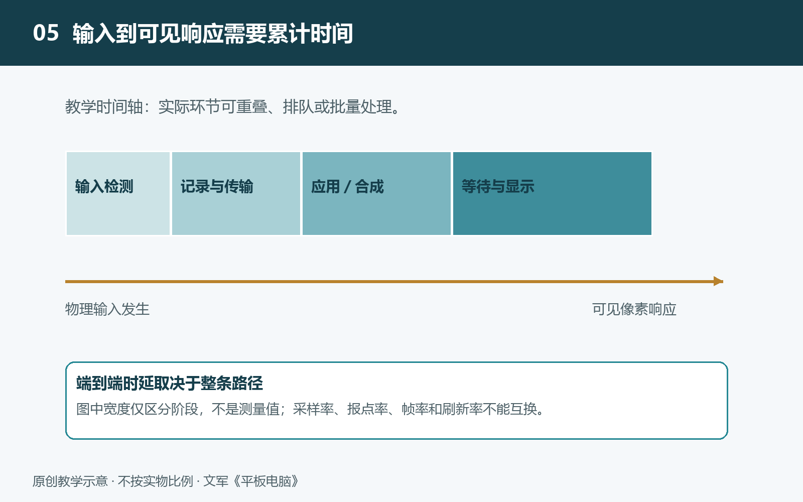

# 5.1 从笔尖到墨迹：输入数据怎样到达屏幕

在平板上写下一个“人”字，看起来只是笔尖移动、线条出现。实际上，屏幕并不是被笔尖直接“染黑”的：感应系统先把动作变成数据，软件再把数据解释为笔迹，显示系统最后让相应像素改变亮度和颜色。追踪这条路径，关键不是寻找一股从笔尖直达屏幕的“电荷流”，而是看清信息如何在不同环节接力。

## 5.1.1 第一站：把笔尖动作变成测量结果

笔尖接近或接触屏幕时，感应系统开始获取位置。不同手写技术的物理方式不同：有的依靠笔与屏幕电极之间的电信号耦合，有的利用电磁感应。压力也不一定由屏幕直接测出，可能由笔内的压力传感结构获取，再传给平板。因此，“所有手写笔都是靠压弯屏幕、改变电容来定位”并不成立。

感应电路接收到的最初是连续变化、夹杂噪声的电信号。电路需要对它进行放大、筛选和数字化，再由控制逻辑估计笔尖坐标。若设备支持，还会形成压力、倾斜角度、接触状态等信息。这些数据共同描述某一时刻的笔尖状态，却还不是屏幕上的线条。

例如，一份输入记录可以表示“某时刻，笔尖位于某处，已经接触屏幕，压力正在增大”。这里的时间信息很重要：只有知道相邻记录之间隔了多久，后续软件才便于判断运动速度，而不是仅凭两个位置之间的距离猜测。

## 5.1.2 第二站：让输入记录到达应用

感应控制器整理好数据后，通过设备内部的通信通路送往计算系统。具体采用哪种接口、是否经过独立控制芯片，要依据机型资料判断，不能从“支持手写”推断其内部连接方式。

操作系统中的驱动程序负责与硬件衔接，把设备提供的数据转换成系统能够处理的输入事件。输入事件可以理解为一张动作通知单，包含位置、时间及其他受支持的属性。系统还要判断通知该交给哪个窗口、哪个应用：同一次落笔，发生在绘图画布上可能开始画线，发生在按钮上则可能触发操作。

手掌同时接触屏幕，会让这条路径更复杂。防误触需要结合笔是否在附近、接触区域形状以及使用状态等信息，区分书写与无意触碰。相关判断可能分布在感应控制器、操作系统和应用中，并非必然由某一颗芯片独立完成。因而，同一台平板在不同应用里的掌托体验也可能不同。

## 5.1.3 第三站：把离散坐标画成连续墨迹

应用收到的是一串按时间排列的位置记录，不是一条天然连续的曲线。绘画软件需要连接这些位置，并根据笔刷规则生成线条。压力可以影响粗细或透明度，倾斜可以影响笔触形状；是否采用、怎样映射，则取决于笔、系统接口和应用的共同支持。

线条平滑也需要处理。直接连接所有测量点，可能放大细小抖动；过度平滑，又可能使转折变圆，甚至让线头更明显地落后于笔尖。有些系统或应用会根据已有运动趋势，暂时估计笔尖接下来可能到达的位置，以减轻视觉上的滞后。但估计并非真实测量，突然转向或停笔时可能需要修正。没有可靠资料，不能认定某款设备必然采用特定预测算法。

生成笔迹图像后，应用还要把它交给后续显示环节。屏幕上通常同时存在画布、工具栏、其他窗口等内容，系统需要将这些图像组织成最终画面。部分平台设有缩短手写显示路径的机制，但并不是所有输入都固定经过同样多的处理步骤。

## 5.1.4 第四站：等待画面真正变得可见

准备好图像，不等于墨迹已经进入眼睛。显示系统还要按相应时序传送画面，面板驱动电路更新像素，像素完成亮度或透光状态的变化，读者才能看到新的线段。多数平板屏幕并非在同一瞬间更新所有位置，因此笔尖位于屏幕何处、数据何时赶上刷新时机，都可能影响可见时间。

这里必须分清三个指标。采样率表示感应系统每秒进行多少次采样；报点率表示向后续环节提供位置记录的频率，两者不一定相同。刷新率表示屏幕每秒更新画面的次数。端到端时延则是从约定的笔尖动作发生，到对应墨迹可见之间的总时间，包含感应、传输、处理、等待和像素响应等环节。

以稳定的120赫兹刷新为教学示例，相邻刷新周期约为8.3毫秒。这只描述显示节奏，不能直接当作手写总延迟。即使感应系统更频繁地采样，应用处理较慢或错过显示时机，墨迹仍可能落后。比较厂商公布的延迟数据时，也应核查测试应用、笔刷、刷新模式，以及是否包含预测效果。

## 5.1.5 沿着链条观察，而不是凭感觉归因

可以在同一应用中选择简单细笔刷，保持缩放比例不变，分别缓慢画线和较快画线，观察笔尖与线头的间距。间距会受到移动速度影响，因此“落后几毫米”不能直接等同于“延迟几毫秒”。换用复杂纹理笔刷后若滞后增大，只能提示渲染负担可能参与其中，不能据此认定感应硬件变慢。

从动作到数据、从数据到图像、从图像到可见墨迹，这条接力链说明：手写响应不是某一个高参数独自决定的。理解各站的职责，才能继续追问，系统究竟在哪里花了时间，又在哪里减少了等待。
