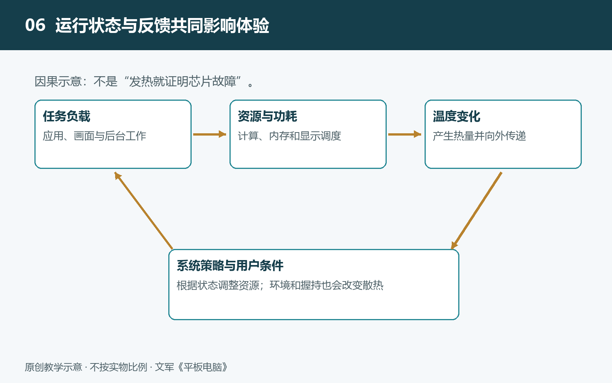

# 6.1 多任务与窗口管理：应用怎样共享计算和内存资源

一边播放课程视频，一边查阅资料，再用手写笔记录重点，是平板电脑常见的使用场景。屏幕上似乎有几个应用同时忙碌，但窗口只是我们看得见的表面。窗口背后，计算、内存和显示资源都需要分配。理解多任务，关键不是数一数打开了多少个窗口，而是追问：哪些任务正在执行，哪些数据仍被保留，哪些画面需要更新？

## 6.1.1 窗口可见，不等于任务始终运行

窗口管理，是系统安排应用显示位置、大小、遮挡关系及输入去向的机制。分屏把屏幕划成几个区域，自由窗口允许重叠与缩放，但这些形式并不直接决定应用能获得多少计算资源。不同系统、软件版本、设备型号和应用，对窗口数量、后台活动及外接显示器的支持也可能不同。

例如，视频窗口可以持续更新，旁边的文档窗口却只在翻页或输入时改变。被遮住的音乐应用可能继续播放，而离开前台的绘图应用可能暂停画面更新。这并不矛盾：播放音频、接收输入、绘制界面是不同工作，系统可以分别管理。

因此，任务切换界面中的一张缩略图，只能说明系统保留了某个界面的视觉记录，不能证明应用仍在持续计算。判断应用状态，需要结合它是否继续播放、是否重新加载，以及返回后能否恢复原来的操作位置。

## 6.1.2 计算资源按需要轮流分配

处理器执行程序指令的核心称为CPU核心。多个应用会产生许多待执行的工作，系统中的“调度器”负责决定这些工作何时、在哪个核心上运行。即使核心数量少于待处理任务数量，也可以通过快速轮换，让用户感觉多个任务正在同时推进；不同核心也能真正并行执行部分工作。

不过，轮换并不会凭空增加算力。手写输入、视频播放和文件导出同时发生时，它们仍可能争用处理器时间、内存带宽或其他资源。系统通常会重视直接影响交互的工作，但具体优先级取决于系统策略和应用实现，不能断言后台导出一定会让位于笔迹绘制。

平板也并非把所有任务都交给CPU。GPU负责许多图形计算，专用视频单元可以承担受支持格式的解码，显示电路参与画面输出。各单元分工能够提高效率，却不能消除所有瓶颈。例如，视频是否采用硬件解码，还与编码格式、应用支持和播放条件有关，不能仅凭“正在播放视频”就认定CPU负担很轻。

## 6.1.3 内存保存工作现场，但容量不是通行证

运行内存是程序执行时暂存数据的空间。文档内容、网页资源、绘图图层以及待显示的图像，都可能占用它。存储器则主要负责较长期地保存应用和文件。两者用途不同：剩余存储空间很多，不代表运行内存就充足。

当多个应用需要的内存增多时，系统会设法回收空间。可以重新生成或重新下载的缓存，往往可以先释放；应用也可能收到通知，主动减少不必要的数据。部分系统会压缩暂时不用的内存内容，以额外计算换取空间。压缩效果取决于数据本身，并不存在适用于所有应用的固定压缩比例。

有些系统和设备还支持把部分内存数据暂存到内部存储中，称为交换。它能缓解内存压力，却受到存储速度、访问延迟、功耗和实现方式的限制，不等于增加了同等容量的物理内存，也不是所有平板都会采用的办法。

如果资源仍然不足，系统可能终止某些后台应用。再次打开时，应用需要重新启动，并尝试恢复此前保存的状态。所以，大内存通常能增加周转余地，却不能保证任意数量、任意规模的桌面负载都能同时运行；应用自身限制、系统规则和散热能力同样重要。

## 6.1.4 多窗口还需要把画面合成在一起

每个可见应用通常先准备自己的画面，再由系统把窗口、菜单、光标等内容组合成最终显示结果，这一步称为“合成”。合成器既要处理窗口的位置和遮挡，也要配合屏幕的刷新节奏。

某些条件下，显示硬件能够直接组合部分图层，减少GPU工作和不必要的数据复制。但图层数量、透明效果、缩放方式及硬件能力都会影响采用哪条处理路径。“硬件合成”不意味着所有窗口都能零成本显示，更不保证任何负载下都不会掉帧。

拖动一个半透明窗口，可能比显示两个静止文档需要更多处理。窗口缩小也不一定让应用负担按面积同比下降：应用可能仍在执行原来的计算。因此，多任务体验既受窗口呈现方式影响，也受窗口内部究竟在做什么影响。

## 6.1.5 用一次日常观察区分不同现象

可以先保存文件，再选择一个文档应用、一个网页和一段普通视频，记录设备型号、系统及应用版本。在全屏、分屏和正常切换之间比较：视频是否继续播放，文档位置是否保留，网页是否重新加载，输入是否出现明显等待。保持亮度、电源模式和网络条件尽量一致，不必故意制造极端负载。

观察时要避免过早归因。网页刷新可能与内存回收有关，也可能来自网站策略或网络变化；返回应用后停顿，可能是重新启动，也可能是在读取文件。只有结合重复观察、应用说明或可靠诊断信息，才能缩小解释范围。

多任务的本质，是系统在有限资源中维持交互、保存工作现场并控制成本。窗口告诉我们任务在哪里呈现，调度与内存管理则决定它们怎样继续。理解这一区别，才能进一步分析手写等实时任务为什么有时流畅，有时需要等待。
