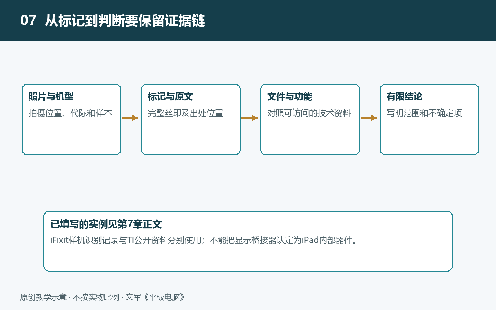

# 7.1 从主板照片到器件身份：芯片外观与丝印识读

打开一份平板电脑拆解报告，主板上最醒目的往往是大小不一的黑色方块。它们看起来相似，承担的任务却可能完全不同：执行计算、保存数据、管理电源，或处理声音与输入。识别这些器件，不是凭外观猜品牌，而是把照片中的线索与可核查资料逐步对应起来。我们要回答的也不只是“它叫什么”，还包括“凭什么认定”。

## 7.1.1 先确认照片属于哪一台设备

识读芯片之前，先核实照片的身份。产品名称相近，不代表主板相同；同一系列的不同尺寸、无线网络版本和移动通信版本，也可能采用不同布局。同一产品还可能因硬件修订或生产批次而更换部分器件。

可靠拆解资料应尽量交代设备的准确型号、版本、照片来源和拍摄对象。阅读时还要分清：这是主板正面、背面，还是屏幕总成上的小电路板？一张被裁去背景的芯片特写，可以展示标记，却未必能证明它来自哪款平板。因此，最好同时保留整板照片与局部特写，让器件位置有据可查。

这里的学习以公开拆解照片为主，不需要自行揭开屏幕、拆除屏蔽罩或处理电池。照片不够清晰时，应寻找更好的资料，而不是把实际设备变成验证猜测的试验品。

## 7.1.2 外观提供线索，不直接提供答案

芯片外部的保护结构称为“封装”。它既保护内部电路，也通过引脚或焊接接点与电路板连接。照片中看到的黑色方块，通常就是封装，而不是裸露的半导体芯片。

封装尺寸、形状和周边器件，可以帮助缩小判断范围。例如，电源转换电路附近常见电感和电容；靠近接口的区域可能布置保护器件或接口控制电路。但这些只是功能线索：电感附近不一定就是整机电源管理芯片，屏幕连接器旁边也不一定存在独立的显示时序控制芯片。

判断时应把“位置关系”与“电气连接”分开。照片能显示两个器件距离较近，却未必显示它们是否相连。主板内部还有多层走线，部分芯片也可能叠封在一起。因此，不能简单地数黑色方块来统计功能，更不能把一张照片中看不见的器件判定为不存在。

## 7.1.3 丝印究竟能告诉我们什么

器件表面的文字、数字和图形，常被统称为“丝印”；实际标记也可能通过激光形成。其中可能包含厂商标志、产品代码、批次代码、生产日期或封装信息，但并不是每一行都对应可购买的完整型号。

第一步是忠实抄录。保留换行顺序，记录标志和方向；看不清的字符用问号标出，不要为了凑成一个熟悉型号而补字。数字“0”与字母“O”、数字“1”与字母“I”，在低清照片中尤其容易混淆。提高对比度可以辅助辨认，却不能让原本缺失的细节变成可靠证据。

第二步才是查询。优先查找芯片厂商公开的产品页、规格书和封装标记说明。规格书是描述器件功能、电气条件与封装等信息的技术文件。如果表面只有简短代码，就需要核对它与完整料号之间的对应关系。仅仅因为搜索结果中出现相同字母，就认定找到了芯片，风险很高。

定制器件还可能没有公开型号解释。此时，“可读标记为某代码，具体型号未知”就是合格结论。承认未知，比套用另一台设备的识别结果更有价值。

## 7.1.4 用多条证据交叉核对

可以把识别过程理解为逐步收紧的筛选：先确认设备与照片来源，再读取标记，随后查对应资料，最后核对封装和功能是否相符。

下面是一种教学假设：某拆解照片中，一颗器件位于显示连接器附近，表面标记能完整读出；拆解报告将它标注为显示相关控制器。若厂商公开资料进一步表明，该型号的封装与照片一致，功能也涉及显示信号处理，这些证据便相互支持。反过来，如果公开资料显示它实际是接口桥接器，就应修正原先判断，不能只凭位置坚持称其为时序控制器。

核对还要注意证据是否真正独立。多个网站转载同一张标注图，并不等于多次验证。拆解作者的注释是有用线索，但仍应检查其依据。厂商规格书可以说明某型号能够做什么，却不能单独证明某台平板使用了它；后者仍需要对应设备的实物证据。

## 7.1.5 把识别结果写成有边界的结论

记录时，可以将结果分成三个层次：能够直接观察的内容、得到资料支持的身份，以及仍待核实的判断。例如：“照片中可见三行标记”属于观察；“标记与官方封装说明对应”支持身份确认；“它可能负责某项配件控制”若缺少连接资料，就仍是推断。

尤其不要把功能需求当成器件清单。平板需要完成显示时序控制，但这项功能未必由主板上一颗独立芯片承担；大屏需要触控检测，也不意味着必须使用两颗触控芯片。系统信息软件显示的名称同样需要谨慎对待：它可能来自驱动配置或数据库，不能自动替代实物核对。

从照片走向器件身份，核心能力不是记住更多供应商名称，而是建立可追溯的判断链。知道哪些已经确认、哪些只是可能、哪些仍然未知，才能继续可靠地阅读技术资料，理解器件在真实系统中的职责。
