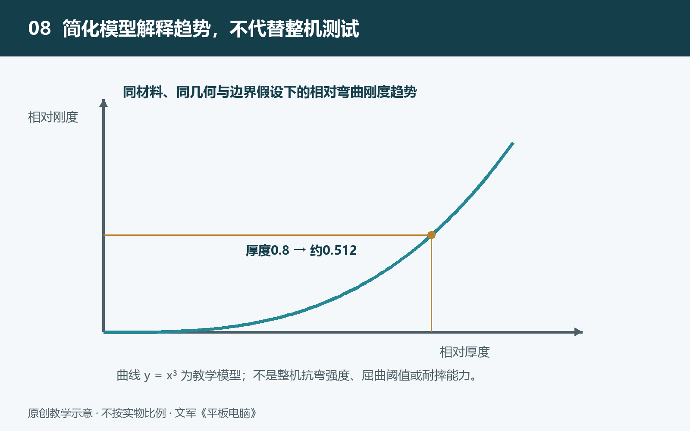

# 8.1 薄板与材料力学：厚度、材料和结构怎样影响刚度

把平板电脑平放在桌上，与用支架托住它的一条边，是两种不同的受力情形。设备没有改变，支撑位置却改变了内部传力的路径。为什么大屏设备既要控制厚度，又要认真安排边框、背板和内部支撑？答案不能只从“金属是否坚硬”寻找，还要看材料放在哪里、各部分怎样连接，以及外力从哪里进入机身。

## 8.1.1 先分清：刚度不等于强度

刚度描述物体抵抗变形的能力。在相同支撑和加载条件下，受到同样大小的力，变形较小的结构，刚度较大。强度则关心材料或结构在多大载荷下会发生屈服、断裂等失效。屈服是指材料开始产生卸载后不能完全恢复的变形。

因此，“不容易弯”和“不容易坏”不是同一句话。有些结构能产生较大弹性变形，卸载后仍恢复原状；有些材料虽然变形不明显，却可能在局部缺陷处突然开裂。玻璃还容易受到表面划伤、边缘损伤等因素影响，不能仅凭看起来挺直就判断它安全。

讨论平板时，也应区分整机弯曲、局部凹陷和屏幕破裂。这些现象对应的载荷与失效过程不同，不能用一个“硬度”概念全部解释。日常所说的抗划伤能力，同样不等于抗弯刚度。

## 8.1.2 厚度为什么有显著影响

想象一条均匀材料制成的细长薄条。它弯曲时，一侧被拉长，另一侧被压短，中间附近存在纵向伸长与缩短接近于零的位置，称为中性层。离中性层越远的材料，在同样弯曲程度下，伸缩越明显，也越能参与抵抗弯曲。

对于均匀、矩形截面的简化梁，截面二次矩为：

\(I=bt^3/12\)

这里，\(b\) 是截面宽度，\(t\) 是沿弯曲方向的厚度；\(I\) 表示截面几何形状对抗弯的贡献，不是质量大小。梁的抗弯刚度由 \(EI\) 表征，其中 \(E\) 是弹性模量，表示材料在弹性范围内抵抗拉伸、压缩变形的能力。

在同材料、同宽度、同跨度、同支撑和加载条件，并满足小变形等简化梁模型假设时，抗弯刚度与厚度的三次方成正比。作为教学假设，若一根均匀薄条的厚度降为原来的八成，其抗弯刚度约剩原来的百分之五十一。同一载荷下，弯曲变形就可能接近原来的两倍。

这个结果解释了厚度为何是重要的设计变量，却不能直接用于比较两台平板。产品标注的整机厚度，并不等于一块实心、均匀金属板的厚度。机内有空腔、开孔、不同材料和连接界面；只把两台设备的外形厚度代入立方关系，不能得出整机刚度，更不能得出强度结论。

## 8.1.3 从细长梁走向大面积薄板

平板的背板通常不是狭长薄条，而是两个方向都有一定尺寸的薄板。薄板受力时，载荷可以沿多个方向传递，长宽比例、边缘约束和受力位置都会影响变形。桌面支撑、支架夹持与手掌托举，因而不能视为同一种测试条件。

对于均匀、各向同性、等厚且满足小挠度假设的薄板，经典模型中的弯曲刚度仍包含厚度的三次方。各向同性意味着材料在不同方向具有相同的力学性质；小挠度则要求变形足够小，使模型中的简化仍然合理。真实机身若存在复杂筋条、复合材料或较大变形，就需要更合适的模型。

还应把弯曲与屈曲分开。弯曲通常指横向载荷使结构产生弯曲变形；屈曲则是结构在某些压缩载荷下失去原有稳定形态。屈曲门槛与形状、约束和初始缺陷有关，不能仅用厚度立方关系判断。

## 8.1.4 材料放在哪里，与用了多少同样重要

工程设计不只是增加材料，也会改变材料的分布。边框、折边、加强筋以及局部较高的截面，都可能让一部分材料远离中性层，提高抵抗特定方向弯曲的效率。建筑中的工字梁体现了相似思路，但这并不意味着每台平板内部都采用工字形结构。

材料选择也不是简单地寻找“最硬的金属”。弹性模量影响弹性变形，屈服强度影响永久变形的出现，密度影响重量，加工方式又影响形状与制造成本。某种合金的强度提高，并不意味着它的弹性模量会按相同比例提高。

屏幕、背板和中框若通过可靠连接共同承载，可能形成比各自独立时更有效的整体结构。不过，这取决于连接是否能传递载荷。胶层的性质、厚度、温度和老化状态都可能影响协同程度。因此，看见全贴合或金属机身，仍不足以推断整机抗弯表现。

## 8.1.5 用安全观察建立力学判断

理解这些关系，不需要按压屏幕或尝试弯折设备。可以从厂商结构说明和可靠拆解照片中，寻找边框、支撑件、开孔与连接位置，并记录资料对应的具体型号。照片能够提示传力路径，却不能代替受控力学测试。

比较测试结果时，还要追问：支撑间距是否相同，载荷施加在哪里，记录的是变形还是破坏，样机是否已有损伤？缺少这些条件，“承受多少力”的数字便难以比较。

厚度提供空间，材料提供基本性能，结构与连接决定这些性能怎样被利用。把三者放在一起，才能理解轻薄机身的工程折中，也才能避免从一条简化公式跳到整机安全性的结论。
