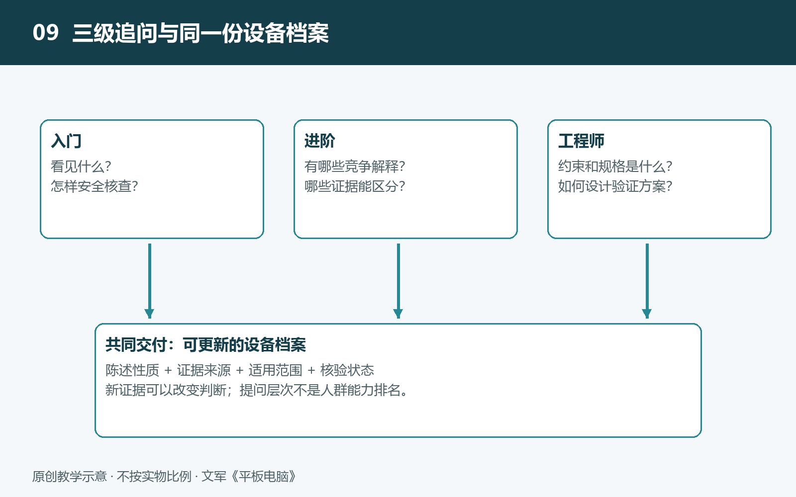

# 9.1 建立协同学习边界：区分观察、推断、教学假设与事实

把平板电脑的照片交给支持图片输入的AI，问“它为什么这样工作”，可能得到一段术语丰富、逻辑连贯的解释。然而，解释流畅，不等于证据充分。一张背面照片能显示摄像头、接口和外壳标记，却不能直接显示电池连接方式，更不能揭示系统采用哪种笔迹预测算法。协同学习的第一步，是让每句话都带着清楚的身份：它是看见的现象、提出的解释、便于理解的假设，还是已有证据支持的事实。

## 9.1.1 观察：先写发生了什么

观察是通过感官或工具，在明确条件下获得的记录。例如：“平板放在桌面上，合上保护套后屏幕熄灭；重新打开后，屏幕亮起。”这比“保护套里的磁铁触发了霍尔传感器”更接近原始观察，因为后一句已经加入了内部机制的解释。

观察也有边界。“屏幕熄灭”不等于“整机断电”；“背面摸起来温热”不等于“芯片达到某个温度”。照片记录的颜色还可能受到曝光、白平衡和环境光影响，不能直接当作屏幕真实色彩的测量结果。

可以给AI这样的要求：

> 我观察到：［现象］。设备型号与系统版本为：［已知信息］，当时的操作和环境为：［条件］。请先用不包含内部机制的语言整理观察记录，并列出还缺少哪些信息。不要把我的感受改写成测量数值。

预期成果是一段可重复检查的描述。即使暂时没有解释，这份记录也已经有价值：别人知道你做了什么，能够判断是否观察到了同一种现象。

## 9.1.2 推断：解释必须容许其他可能

推断是从观察出发，提出可能的原因。保护套闭合后熄屏，可能与磁性检测有关；但仅凭一次现象，也需要考虑自动锁屏计时是否恰好到期、套盖是否碰到了按键等可能性。提出竞争解释，不是故意怀疑一切，而是避免把第一个想到的答案当成唯一答案。

面对“写字时墨迹落后于笔尖”，AI可以提出输入采样、应用处理、显示更新等环节的影响，但不能仅凭一段普通视频，就断定某颗芯片故障，或宣称某种算法没有开启。多个环节都可能产生相似表现，视频本身还受拍摄帧率和拍摄角度影响。

此时可继续追问：

> 请给出两到三个可能解释，分别指出它能解释哪些现象、还缺少什么证据，以及哪种安全的外部观察有助于区分它们。若目前无法区分，请明确保留多个解释。

回答应留下“候选原因与区分线索”，而不是一张未经验证的故障判决书。若需要比较应用，可保持设备、笔刷和书写动作尽量一致，每次只改变一个条件；不要同时更换应用、笔尖和充电器，再把结果归给其中某一项。

## 9.1.3 教学假设：模型有用，但不是设备自述

教学假设是为了说明原理而暂时设定的条件。例如，假设笔尖沿直线匀速移动，可以用“当前位置加上速度乘以时间”解释短时外推。这个模型能帮助理解预测为何可能缩小可见的跟随差距，也能说明急停、转弯时为何容易预测失准。

但它并不证明某款平板采用匀速模型，更不能证明系统内部使用卡尔曼滤波。真实产品可能组合多种处理方法，具体实现也可能随系统和应用版本变化。

向AI索要推演时，应把身份写在问题里：

> 请建立一个解释手写预测的教学模型。先声明假设，再用简单数字演示，并说明哪些真实因素被省略。所有数字均标为教学设定，不要写成这台设备的实测结果。

这样得到的成果应分为三部分：设定条件、推演过程、适用边界。假设并不低于事实，它承担的是另一项任务：让复杂关系变得可理解。问题只出在把“如果如此，会怎样”悄悄改写成“这台设备就是如此”。

## 9.1.4 事实：把结论连接到可追溯证据

事实性陈述需要与具体证据相连。“某型号支持某支手写笔”，可以查询厂商兼容列表；“某次拆解样机中有两块电池”，需要对应的拆解图片、机型信息与说明。后者不能自动推广为同系列所有版本，更不能推广为所有平板电脑。

还要分清资料能证明什么。芯片规格书列出的能力，不代表整机启用了全部功能；厂商公布的续航时间附带测试条件，不是任何使用方式下的保证；拆解照片中的外观和丝印，也未必足以确认器件的完整型号。

可以要求AI这样整理依据：

> 请将结论与依据逐条对应，提供可定位的资料名称、发布主体、日期或版本，以及相关段落。区分资料直接说明的内容与你的推导。无法访问或没有找到的资料，请写明，不要补造引用。

保留资料原文或截图、访问日期和适用型号，通常比只收藏AI的摘要更可靠。重要的不是来源数量多，而是证据是否真正支持那句话。

## 9.1.5 留下一份可以修订的学习记录

一次协同学习结束时，不要把“观察、推断、教学假设、事实”当作四个互斥抽屉。分别记录陈述性质（观察、解释、教学设定等）、证据来源、适用型号或样本，以及核验状态（已核对、有限支持、待核实、存在冲突）。同一条观察可以是有证据支持的事实，一项推断也可以得到有限支持；教学假设说明推演用途，不等于一类较低等级的事实。新资料出现时更新状态与解释，原记录仍保留。

所有核查都应停留在安全边界内：不拆电池，不弯折机身，不用强磁体试探内部结构，不以高温或持续重载逼出保护状态。若出现鼓包、异味、异常烫热或充电异常，应停止相关尝试，按厂商指引寻求服务。

学会分类后，AI就不只是给答案的工具，而是帮助组织证据、比较解释和暴露未知的伙伴。下一步再让它看照片、读资料，我们才能清楚地区分：图中看见了什么，又有哪些内容仍藏在图像之外。
