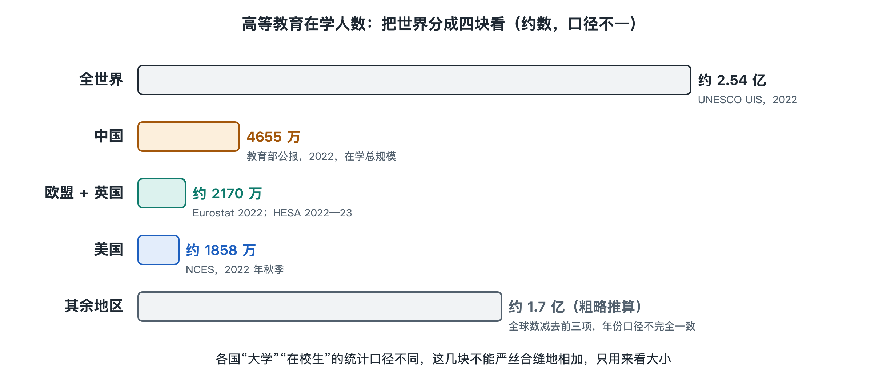

# 1.2 大学有多大：把世界放在一张图上

一所大学有多大，可以站在校门口看：几栋楼、几片操场、多少学生从食堂出来。把镜头拉到全世界，事情就没这么简单了。地图上能标出的大学有多少所？在里面学习的人有多少？这两个问题看似只要查表，实际先要决定：什么算一所“大学”，什么算一个“在校生”。

## 1.2.1 先定口径：数学校，也数人

按联合国教科文组织统计研究所（UNESCO UIS）的高等教育统计口径，2022年全球接受**高等教育**的人约有2.54亿。这里的高等教育不只指以“大学”命名的学校，还包括符合相应教育层级的学院和其他机构。它数的是人，不是校门口写着“大学”的招牌。

数学校更难。国际大学协会维护的“世界高等教育数据库”（WHED）收录了全球两万多所获得本国主管部门认可的高等教育机构。这个数字适合用来感受规模，却不能直接读成“世界大学总数”：数据库有收录条件，各国给机构起的名称也不同。一所大学可能设有多个校区；另一些国家则有许多独立的学院。把校区当学校数，和把整所大学当学校数，结果会差得很远。

这里有一段不大为人注意的统计史。联合国教科文组织的《国际教育标准分类》在1976年首次推出，后来经过修订；今天常用的2011年版本把高等教育分为第5至第8级，涵盖短周期高等教育、本科、硕士和博士。世界各国原本使用不同的学制和名称，国际统计必须先把它们放进可以对照的格子，才谈得上相加。我们看到的“全球在校生”，不是从各国报表上抄下一列数字再按计算器得出的。

下面把地图暂时分成四块。人数尽量选取2022年前后的公开数据；学校数量则注明各自的统计范围。它们能帮助我们看清大小，却不是一套可以严丝合缝地相加的账本。

## 1.2.2 美国：大学不只是一种学校

美国国家教育统计中心统计，2022年秋季，授予学位的高等教育机构约有1860万名学生。按该中心2022—2023学年的机构统计，这类学校有3896所。两年制的社区学院和四年制大学都可能在其中；如果只数研究型大学，数字会小得多。

一个住在美国大学城附近的人，可能把“上大学”理解为住进校园、读四年本科；另一个人则可能白天工作、晚上到社区学院上课。两人都在高等教育的统计图上。数字把他们放在一起，并不意味着他们度过的是同一种校园生活。

## 1.2.3 欧洲（含英国）：先说清边界

“欧洲有多少大学生”尤其容易得到几个互不相同的答案。欧盟不是整个欧洲，英国也已不在欧盟的统计合计之内。按欧盟统计局的数据，2022年欧盟高等教育学生约1880万人；英国高等教育统计局记录的2022—2023学年学生约294万人。把这两项并排放置，约为2170万人，但它仍不是“全欧洲总数”：挪威、瑞士等欧洲国家没有被算进这两项。

学校数量也不能随手从两个机构的网页上摘下来相加。欧洲各国有大学、专业学院和其他高等教育机构，国家报表对分校、独立学院的处理未必一致。因此，这张图在欧洲这一块给出可核对的欧盟与英国学生人数，不用一个未经统一口径的“大学所数”制造整齐的假象。边界画在哪里，本身就是数字的一部分。

## 1.2.4 中国：看清“在学总规模”

教育部《2022年全国教育事业发展统计公报》给出的数字是：全国共有高等学校3013所，其中普通本科学校1239所、本科层次职业学校32所、高职（专科）学校1489所，成人高等学校253所；各种形式的高等教育在学总规模为4655万人。这是一幅很大的图：只看人数，中国这一项就远超前面列出的美国或欧盟。

但“各种形式的高等教育在学总规模”并不等于“每天坐在普通本科教室里的学生”。公报用这几个字提醒读者，它覆盖的学习形式比普通全日制本科宽。把4655万人写成“中国大学本科生”，就像把一家医院一年的门诊人次都算成住院病人。学校数也一样：3013所包含成人高等学校，不能未经说明便与只统计某类授予学位机构的美国数字直接比较。

## 1.2.5 其余地区：地图上不能略去的大多数

把前面几块涂上颜色，地图还有大片地方没有上色：印度、印度尼西亚、巴西、尼日利亚，以及欧洲未列入欧盟和英国两项的人，都在其中。这些地方不是统计后的“零头”。如果只拿全球约2.54亿人与上述几项人数作粗略对照，剩下的量级仍在一亿多人；但由于年份和统计范围并不完全一致，不能把减法所得的小数点后数字冒充“其余地区在校生总数”。同样，也不能用WHED收录的两万多所，减去美国和中国不同口径的学校数，得到一个可靠的其余地区学校数。

这张世界图最终给出的是两个清楚的印象：大学及其他高等教育机构数以万计，身在其中学习的人以亿计；而每一个看似简单的总数，背后都有一道“把谁算进去”的边界。站回身边那所大学的校门口，它只是地图上的一个点。点与点放在一起，才显出大学在今天的世界究竟有多大。

**本节数据与口径出处：**联合国教科文组织统计研究所（UNESCO UIS）高等教育统计及《国际教育标准分类：ISCED 2011》；国际大学协会“世界高等教育数据库”（WHED）机构介绍；美国国家教育统计中心（NCES）高等教育机构与秋季招生统计；欧盟统计局（Eurostat）2022年高等教育学生统计；英国高等教育统计局（HESA）2022—2023学年学生统计；中国教育部《2022年全国教育事业发展统计公报》。
