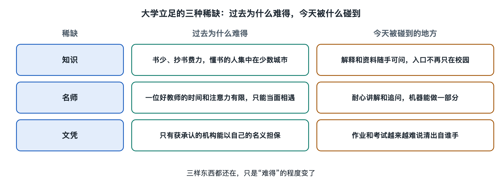

# 1.4 名师和文凭：另外两种稀缺

一个人想学一门学问，可以买书，可以听公开课，也可以向 AI 提问。可人们仍会问：“是谁教的？”学完以后，又会问：“有没有大学承认？”这两句话指向大学立足的另外两样东西：名师和文凭。它们都和知识有关，却不能简单地算作知识本身。

## 1.4.1 名师难遇：人们为什么愿意远行求学

十二世纪的巴黎，有位教师叫彼得·阿伯拉尔。他在自传《我的灾难史》（*Historia Calamitatum*）里写过一段经历：他离开巴黎，退到乡间，学生听说他在那里讲学，又赶去追随。人多到住不下，便在附近搭起简陋的棚屋。这是当事人的回忆，不该当作一份精确的招生记录；但它留下了一个清楚的场景：还没有便利的交通和通信时，学生会为听一个人讲课而迁居。

那时的巴黎学术团体还不是今天这套校园、院系和课程。求学者追随的首先是能教自己的人。书可以抄，教师却不能抄。一个好教师熟悉学问走过的路，知道初学者在哪一步容易误解，也能在学生自以为说清楚时，再问一句：“你的根据呢？”这些能力要在相处中才能领会。即使两个人拿着同一本书，跟不同的人学习，也可能走上不同的路。

今天，人们不必像阿伯拉尔的学生那样搭棚求学。英国牛津大学官网介绍本科教学时，仍把小规模的**导师讨论课**（tutorial）列为其教学特色：学生带着阅读和写作成果，与导师当面讨论。名师难遇，不只是因为他们的人数少，也因为一个人能分给学生的时间和注意力有限。

## 1.4.2 大学的声望：一位学者怎样让一所学校被看见

说起一所大学，人们有时先想到校名，有时却先想到一个人的名字。十九世纪后期，英国剑桥大学建立卡文迪许实验室，詹姆斯·克拉克·麦克斯韦担任首任卡文迪许实验物理学教授。剑桥大学卡文迪许实验室的院史记载，实验室于1874年开放。麦克斯韦此前在电磁学上的工作，已经使他的名字广为物理学界所知；把他请到这里，也让新实验室从一开始就与高水平研究联系在一起。

当然，不能把一所学校的成就记在某位学者一人名下。实验室要有场地、仪器、合作者和后来的一代代研究者。只是从校外看，人们很难逐项检查这些条件，人的名字反而容易记住。某位学者在那里任教，可能使学生愿意申请、同行愿意来访，也可能让公众第一次注意到这所学校。

名师的声望与大学的声望因此会相互借力，却不是同一件事。学者可以换工作，退休后也有人接任；大学则要把不同年代的人和工作接续起来。一位著名教师可以让学校被看见，学校却不能仅凭一位教师的名字，就保证每个学生都能得到他的指导。人们说“我去那里，是因为那里有某某教授”时，想到的那个人，与入学后实际能够接触到的人，中间仍隔着距离。

## 1.4.3 文凭难得：学到知识与获得社会承认的学位不是一回事

再看另一种情形。美国麻省理工学院把大量课程材料放在 MIT OpenCourseWare 网站上。任何人都可以打开网页，查看讲义、作业和部分课程视频。网站的常见问题说明也写得明白：使用这些材料，不会得到麻省理工学院的学位或证书。

这里的区别不是“网上学的一定不如校园里学的”。一个人完全可能凭公开材料认真掌握一门课；坐在教室里的人也未必真正学会。区别在于：知道一件事，是学习者自身的状态；取得学位，则意味着一所具有相应资格的机构，以自己的名义对外确认了某种学习经历和成就。旁人未必能直接看见你脑中的知识，却能读懂证书上的学校名称和学位名称。

大学也不是世界上唯一能颁发学习证明的机构。职业培训机构可以发证书，行业组织可以授予资格，不同国家对哪些机构有权授予学位也有不同规定。但社会所说的大学学位，有特定的颁授主体和公共含义。书谁都能自学，学位却只能由学校来签。

## 1.4.4 名师与文凭：人们为何不只在大学之外学习

名师和文凭，满足的不是同一种期待。想找名师的人，希望得到自己难以从书本独自获得的讲解和回应；想取得学位的人，希望学习成果有一个校外的人也认得的名字。前者指向具体的人，后者指向机构的承认。名师可能在大学之外讲课；人也可以在大学之外学到大量知识。但当人们决定是否进入一所大学时，仍常常把这两件事放在一起考虑。

它们也都不等于保证。去了一所名师云集的大学，不表示人人都能与名师相熟。只是校外的人很难亲自旁听每一堂课、检查每一次学习。他们看到教师的名字、学校的名字和证书上的字，便有了几个能够辨认的线索。

阿伯拉尔的学生赶路，是为了见到一个人。今天有人打开公开课，能听到远方教师的声音，却仍拿不到那所学校的学位。名师与文凭一近一远：一个贵在相遇，一个贵在承认。大学把这两种不容易得到的东西，放在了同一个名字之下。
