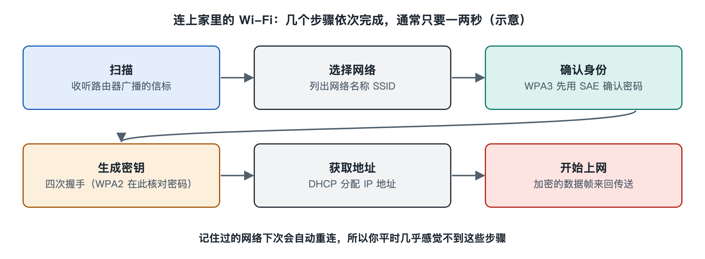

# 1.1 连上家里的 Wi-Fi：手机和路由器之间发生了什么

晚上回到家，掏出手机，屏幕右上角的扇形图标亮了起来，微信消息开始一条条涌进来。整个过程不到一两秒，你甚至没有意识到它发生过。可就在这一两秒里，手机和客厅角落那台闪着指示灯的路由器之间，已经完成了一场有章可循的“对话”：先认出对方，再核对身份，然后交换钥匙，最后领到一个地址。本节就把这一两秒放慢来看，作为全书的起点。

## 1.1.1 路由器在“喊名字”，手机在“听”

路由器开着的时候，一直在做一件事：每隔很短的时间（常见设置约为十分之一秒），通过天线向四周广播一个很小的数据包，叫作**信标帧**（Beacon Frame）。信标帧里写着这个网络的名字，也就是你在手机列表里看到的“MyHome-5G”之类，技术上叫**服务集标识符**（SSID，Service Set Identifier）；还写着它支持哪些速率、采用什么加密方式等信息。

手机这一侧的行为可以分两种：

| 方式 | 做法 | 类比 |
|---|---|---|
| 被动扫描 | 手机逐个信道“竖起耳朵”听信标帧 | 在车站听广播找自己的车次 |
| 主动扫描 | 手机发出**探测请求**（Probe Request），路由器回复**探测响应** | 直接问服务台“去北京的车在哪” |

你打开 Wi-Fi 设置页面时看到的那张网络列表，就是手机把听到、问到的结果汇总起来的产物。列表里信号格数的多少，反映的是手机收到这些信标的强弱。如果手机以前连过这个网络并保存了密码，它会自动挑出熟悉的名字，直接进入下一步。

## 1.1.2 打招呼与“入籍”——认证和关联

找到网络后，手机向路由器发送请求，双方要走两道手续。

第一道叫**认证**（Authentication）。在 802.11 标准里，这一步最初只是一个形式上的“我想加入”“可以”的往返；在使用 WPA3 的网络中，这里会进行一种名为 SAE（Simultaneous Authentication of Equals，对等实体同时认证）的交换，让双方在不直接传送密码的情况下确认彼此知道同一个密码。

第二道叫**关联**（Association）。手机告诉路由器“我支持哪些速率、几根天线、哪一代 Wi-Fi”，路由器回复“同意接入，给你一个编号”。从这一刻起，路由器就把这部手机登记在册了，好比你在小区门卫处登记了住户信息。路由器后台“已连接设备”列表里出现的条目，正对应着这一步。

## 1.1.3 交换钥匙——四次握手

登记完毕还不能马上说话。无线信号是向空中四散的，隔壁邻居的设备也能“听到”。所以双方必须先商定一把只属于这次连接的加密钥匙。WPA2 和 WPA3 都使用一个叫**四次握手**（4-Way Handshake）的过程：路由器和手机来回交换四条消息，各自用共同知道的密码材料加上随机数，算出同一把临时钥匙，而这把钥匙本身从不在空中传输。

可以把它理解为：两个人事先都知道一句暗语，见面时各报一个随机数字，再按同一规则混合计算，得出今天的“通行码”。旁人听到了随机数，却不知道暗语，就算不出通行码。

如果你输错了密码，往往就卡在这一步——手机提示“密码错误”或“无法加入网络”，是因为双方算出的钥匙对不上。至于这些安全机制怎样演进、为什么要用强密码和 WPA3，第三章 3.4 节会专门展开。

## 1.1.4 领到地址——DHCP

钥匙到手，无线这一段的“路”已经通了，但手机还没有在网络里的“门牌号”。它会发出一个广播请求：“谁能给我分一个地址？”路由器里通常运行着一个**动态主机配置协议**（DHCP，Dynamic Host Configuration Protocol）服务，回复一个形如 192.168.1.23 的内部地址，同时告诉手机：出门要经过谁（网关，通常就是路由器自己）、问路找谁（DNS 服务器）。

DHCP 的完整过程常被概括为四步：发现、提供、请求、确认。完成后，手机状态栏的 Wi-Fi 图标才算真正“亮稳”。有时你会看到图标出现了但旁边带个感叹号，或提示“已连接，但无法访问互联网”，问题就常常出在这一步或更后面的有线侧，而不是无线信号本身。

## 1.1.5 一张时间线，和接下来的旅程

把这一两秒串起来，大致是这样一条时间线：

1. **发现**：信标帧 / 探测请求与响应——找到网络；
2. **认证与关联**：确认可以加入并登记能力——成为成员；
3. **四次握手**：生成临时加密钥匙——建立私密通道；
4. **DHCP**：领取 IP 地址和网关信息——获得门牌号；
5. **开始收发数据**：网页、消息、视频在加密的无线链路上来回流动。

这条时间线里藏着全书的许多主题：信标帧和 SSID 属于“发现”功能，认证、关联和握手属于“关联”与“安全”功能，它们都由 802.11 标准中的 MAC 层规定；而真正把数据变成电磁波送到空中的，是物理层的天线、调制和信道。DHCP 则已经越过无线本身，负责分配 IP 地址这类网络层参数，由路由器连接起家里的局域网和外面的互联网（互联网的工作方式详见本丛书第二十五册）。

你每天无数次重复的“连上 Wi-Fi”，其实是一套分工明确的系统在协作。下一节，我们先退后一步，看清这套系统的整体身份：所谓无线局域网，究竟是一根怎样的“看不见的网线”。
