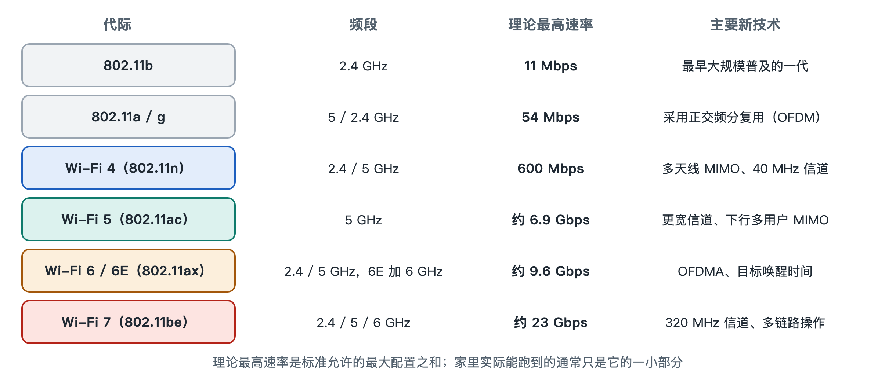

# 1.4 从 802.11 到 Wi-Fi 7：每一代解决了什么问题

打开手机的 Wi-Fi 详情页，或者翻看路由器包装盒，常会看到“Wi-Fi 6”“Wi-Fi 7”这类字样。有些电脑的网络信息里还会写着“802.11ax”“802.11ac”。这些名字容易让人以为每一代只是比上一代“更快”。其实每一代都在解决当时最突出的问题，速度提升只是其中一个结果。本节按时间顺序走一遍这条演进线，看看 Wi-Fi 每一次升级时遇到了什么问题。

## 1.4.1 两套名字：IEEE 编号与 Wi-Fi 代际

先要分清两套名字。IEEE（电气电子工程师学会）负责制定技术标准，用“802.11”加字母后缀来编号，例如 802.11n、802.11ax。这些编号是工程文件的名称。Wi-Fi 联盟（Wi-Fi Alliance）是一个产业组织，负责测试产品能否互通并发放认证。2018 年，Wi-Fi 联盟推出了更好记的代际名称，把 802.11n、802.11ac、802.11ax 分别称为 Wi-Fi 4、Wi-Fi 5、Wi-Fi 6。更早的 802.11a/b/g 没有获得官方代号，坊间有时把它们叫作 Wi-Fi 1 到 3，但这不是联盟的正式命名。两者的分工在 4.3 节还会细讲，这里只需记住一点：一个是技术编号，一个是给普通人看的代际名称。

## 1.4.2 早期：先让无线“能用”，再让它“够用”

| 标准 | 大致定稿时间 | 频段 | 理论最高速率 | 主要解决的问题 |
|---|---|---|---|---|
| 802.11 | 1997 年 | 2.4 GHz | 2 Mbps | 定义无线局域网的基本规则 |
| 802.11b | 1999 年 | 2.4 GHz | 11 Mbps | 速率提高到可以实际使用，促成了普及 |
| 802.11a | 1999 年 | 5 GHz | 54 Mbps | 引入 OFDM，并使用较少拥挤的 5 GHz |
| 802.11g | 2003 年 | 2.4 GHz | 54 Mbps | 把 OFDM 带回 2.4 GHz，同时兼容 b |

最早的 802.11 主要回答一个问题：没有网线，设备之间怎样约定谁先说话、怎样确认对方收到。它的速率很低，用途有限。802.11b 把速率提升到当时足以浏览网页的水平，笔记本电脑开始普遍内置无线网卡。802.11a 采用了 OFDM（正交频分复用，Orthogonal Frequency Division Multiplexing）技术。这种技术把一条宽信道切成许多窄的子载波并行传输，对多径反射的抵抗力更强。第六章会细讲这种技术，它一直沿用到今天。

表中的速率都是标准规定的**理论峰值**，实际使用中通常只能达到其中一部分，原因在第六、第八章展开。

## 1.4.3 Wi-Fi 4 与 Wi-Fi 5：用多根天线和更宽信道“拓宽马路”

802.11n（Wi-Fi 4，2009 年定稿）的关键是 MIMO（多输入多输出，Multiple-Input Multiple-Output）。路由器和终端用多根天线，在同一频率上同时传送几路数据，好比把单车道改成多车道。它还允许把两个 20 MHz 信道合并成 40 MHz，并且可以工作在 2.4 GHz 和 5 GHz 两个频段。理论峰值达到每秒数百兆比特的量级。

802.11ac（Wi-Fi 5，2013 年定稿）集中在 5 GHz 频段，继续把信道加宽到 80 MHz 乃至 160 MHz，并采用更密的调制方式 256-QAM。它还引入了下行 MU-MIMO（多用户 MIMO），使路由器可以同时给几台设备分别发数据。到了这一代，单台设备的理论峰值进入每秒吉比特（Gbps）量级。

这两代主要解决的是**单条链路速度不够**的问题，适合高清视频和大文件传输。

## 1.4.4 Wi-Fi 6 与 6E：从“跑得快”转向“人多也不堵”

到了 2010 年代后期，问题变了。一户人家可能有十几、二十台联网设备，办公室、地铁站和体育场里更是设备密集。这时单台设备的峰值速度已经不是主要问题，瓶颈在于许多设备怎样共享同一段空中资源。802.11ax（Wi-Fi 6）的重点因此转向**效率**：

- **OFDMA**（正交频分多址）：把一个信道分成若干资源块，同一时刻分给多台设备，好比一辆货车同时给几户人家送货；
- **上行与下行 MU-MIMO**：多用户同时传输在上下两个方向都可以进行；
- **目标唤醒时间（TWT）**：设备与路由器约定好醒来的时间，其余时间休眠，可以节省电量；
- **BSS 着色**：给相邻网络的帧打上“颜色”标记，减少不必要的相互避让。

Wi-Fi 6E 是 Wi-Fi 联盟的认证名称，指把 Wi-Fi 6 的能力扩展到 **6 GHz 频段**，相当于新开了一片干净的车道。6 GHz 是否开放、开放多少，由各国监管机构决定。写作时美国、欧盟等国家和地区已开放全部或部分 6 GHz 频段，中国内地尚未向 Wi-Fi 开放该频段。读者购买 6E 或 7 代设备前，应先查阅所在地区的最新规定（详见 4.4 节）。

## 1.4.5 Wi-Fi 7：更宽、更密，还能多路并用

802.11be（Wi-Fi 7，正式名称为“极高吞吐量”EHT）在进一步提升速率的同时，也更重视低时延和高可靠，适合云游戏、视频会议和虚拟现实等应用。它主要有三项变化：

1. **320 MHz 超宽信道**：需要 6 GHz 频段才能完整使用；
2. **4096-QAM**：每个符号携带更多比特，但对信号质量要求更高；
3. **多链路操作（MLO）**：设备可以同时或灵活地使用 2.4、5、6 GHz 中的多条链路，一条拥堵时改走另一条。

Wi-Fi 联盟于 2024 年初启动 Wi-Fi 7 认证。公开资料中常见的理论峰值说法是每秒数十吉比特，这是在所有条件都理想时的数值，家庭实际体验远低于此，而且受到宽带接入速率、终端能力等因素的限制。

## 1.4.6 小结：一条从“连得上”到“用得好”的路线

回顾这条演进线，可以概括为：早期解决“有没有、能不能用”，Wi-Fi 4/5 解决“单条链路够不够快”，Wi-Fi 6/6E 解决“设备多了是否还顺畅”，Wi-Fi 7 解决“时延是否稳定、能否多路并用”。每一代都尽量保持向后兼容，所以老手机仍能连上新路由器，只是用不到新功能。了解这条路线以后，看到包装盒上的代际名称，就可以判断它主要改进了哪方面的问题，而不只是比较一个峰值数字。
