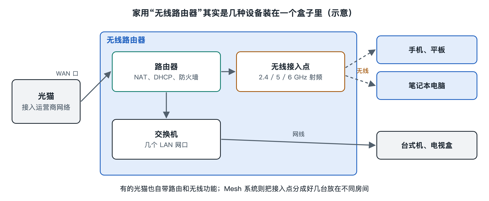

# 2.2 无线路由器与接入点：一台盒子里的几种设备

把家里的无线路由器翻过来看一看：背面通常有一个颜色不同、标着“WAN”或“Internet”的网口，旁边是几个标着“LAN”或数字编号的网口，还有电源接口、复位小孔，机身上可能竖着几根天线，也可能把天线藏在外壳里。底部的铭牌上印着默认的网络名称、管理地址，有时还有一个二维码。

这台巴掌大小的盒子，日常被我们统称为“路由器”。拆开它的功能，里面其实装着好几种不同的网络设备。分清它们，是理解后面所有章节的前提：手机连上 Wi-Fi 却打不开网页、换了新路由器反而多了一层网络、Mesh 套装里的“主路由”和“子节点”有什么区别，这些问题的答案都要回到这里。

## 2.2.1 一台盒子，四种角色

一台典型的家用无线路由器，至少同时扮演四种角色：

| 角色 | 英文及缩写 | 做什么 | 对应的接口或部件 |
|---|---|---|---|
| 无线接入点 | Access Point，AP | 把无线终端接入网络，负责收发 Wi-Fi 信号 | 天线、无线芯片 |
| 交换机 | Switch | 在本地设备之间转发数据，不经过外网 | LAN 网口及内部交换芯片 |
| 路由器 | Router | 在家庭内网与外部网络之间转发数据，决定数据往哪走 | WAN 口与 LAN 侧之间的转发逻辑 |
| 网络服务 | DHCP、NAT、防火墙等 | 给设备分配地址、共享一个公网出口、拦截不请自来的连接 | 路由器内的软件功能 |

可以把它想象成一栋小区的门卫室：接入点是“对讲门禁”，让住户不用钥匙也能进门；交换机是楼内的走廊，住户之间串门不用出小区；路由器是大门，决定包裹往小区外的哪条路送；地址分配和地址转换则像物业登记处，给每户发门牌号，对外统一用小区的地址收发快递。

这四种角色原本是独立的设备。在企业机房里，它们往往仍然分开摆放：墙上或天花板上装着一个个接入点，机柜里放着交换机，出口处是专门的路由器或防火墙。家庭场景追求省事省钱，厂商就把它们集成进了同一台盒子。

## 2.2.2 接入点：真正“说 Wi-Fi”的那部分

在这四种角色里，只有接入点直接和无线有关。它的任务可以概括为三件事：

- **对外广播自己的存在**：周期性地发出信标，告诉周围设备“这里有一个叫某某的网络”（第三章 3.1 节详谈）；
- **管理接入的终端**：决定谁可以加入、记录当前有哪些设备在线、协调它们轮流使用空中信道；
- **在无线与有线之间“翻译”**：把无线终端发来的 802.11 帧转换成有线网络使用的以太网帧，反方向亦然（第四章 4.2 节展开）。

IEEE 802.11 标准把“一个接入点加上连在它上面的所有终端”称为一个**基本服务集**（Basic Service Set，BSS）。每个基本服务集有一个唯一标识，通常就是接入点无线接口的硬件地址，称为 BSSID。而我们在手机上看到的网络名称则是 SSID。一台支持 2.4 GHz 和 5 GHz 的双频路由器，内部往往有两个（或更多）无线接口，各自形成独立的基本服务集，即使对外显示同一个网络名称，它们的 BSSID 也不同。这一点在后面讲漫游和频段选择时会反复用到。

## 2.2.3 路由与交换：WAN 口和 LAN 口为什么不一样

背面那个颜色不同的 WAN 口（Wide Area Network，广域网）连向外面——在多数家庭里是接到光猫上。其余的 LAN 口（Local Area Network，局域网）连向家里的电脑、电视盒子、网络存储等设备。

LAN 口之间、LAN 口与无线终端之间，属于同一个局域网，由内部的交换功能负责转发。你用手机把照片投到同一 Wi-Fi 下的电视上，数据只在家里兜一圈，不经过 WAN 口。

一旦要访问外部网站，数据就要穿过路由功能，从 WAN 口出去。这时路由器还做两件家庭用户常常意识不到的事：

1. **地址分配**（Dynamic Host Configuration Protocol，DHCP，动态主机配置协议）：给每台连上来的设备自动分配一个内网地址，例如常见的 192.168.x.x 这类私有地址段；
2. **网络地址转换**（Network Address Translation，NAT）：家里所有设备对外共用路由器 WAN 口上的那一个地址，路由器记住“哪个内网设备发出了哪条请求”，回复到达时再分发回去。

关于地址和路由的更多细节，本丛书第二十五册《互联网》有系统讲解，这里只需记住：**无线接入解决的是“设备怎样上到这张局域网”，路由解决的是“这张局域网怎样通向外面”**，二者在家用路由器里恰好挤在了一起。

## 2.2.4 同一台设备的不同工作模式

正因为功能是叠加的，很多家用路由器的管理后台提供“工作模式”选项，名称各家不同，常见的有：

| 模式 | 启用的角色 | 典型用途 |
|---|---|---|
| 路由模式 | 接入点 + 交换 + 路由 + 地址服务 | 家里唯一的或主要的路由器 |
| 接入点（AP）模式 / 有线中继 | 接入点 + 交换，关闭路由与地址分配 | 已有一台路由器，再用网线接一台扩展覆盖 |
| 无线中继 / 桥接 | 接入点，并用无线方式连回上级 | 不方便布线时延伸信号 |

这里有一个常见误区：把第二台路由器直接接在第一台下面，并保持路由模式。结果家里出现两层网段、两次地址转换，同一个家里的手机和电视可能“看不见”彼此，投屏和打印时常失败。若第二台设备只是为了扩大覆盖，切换为接入点模式通常更合理。具体菜单名称和选项以各厂商写作时的产品说明为准。

再看光猫。在许多国家和地区（包括中国）的光纤入户中，运营商提供的光猫本身常常也带有路由和无线功能，于是家里可能同时有两台“都能路由”的盒子。哪台负责路由、哪台只做接入，是家庭网络规划中最值得想清楚的一件事，下一节会专门讨论有线一侧的设备。

## 2.2.5 小结：从“一个盒子”到“一组功能”

把路由器看成“一组功能的组合”，而不是一个黑箱，你就获得了拆解任何无线网络的基本方法：先问哪里在做无线接入，再问哪里在做交换、哪里在做路由、谁在分配地址。家用路由器把这几件事集于一身，企业网络把它们拆开部署，Mesh 系统则把接入点复制成多份并让它们协同工作。下一节我们沿着 WAN 口那根网线继续往外走，看看光猫、交换机和网线在这个系统里各自承担什么。
