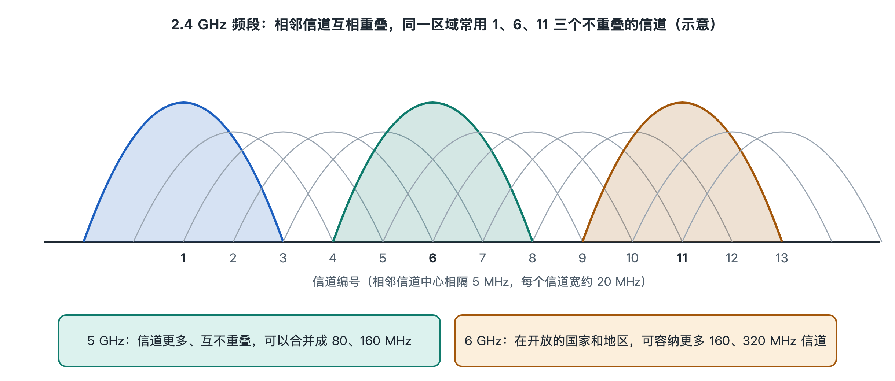

# 2.5 频段与信道：2.4 GHz、5 GHz 与 6 GHz

打开手机的 Wi-Fi 列表，你可能会看到两个名字很像的网络，例如“MyHome”和“MyHome_5G”。很多人以为后者和手机上的 5G 网络有关，其实这里的“5G”指的是 5 GHz 频段，与第五代移动通信不是一回事。同一台路由器为什么要发出两个甚至三个网络？要回答这个问题，需要先弄清两个概念：**频段**和**信道**。

## 2.5.1 频段与信道：马路和车道

无线信号是电磁波，每秒振动的次数叫频率，单位是赫兹（Hz），1 GHz 等于每秒振动十亿次。所谓**频段**（band），就是一段连续的频率范围，Wi-Fi 常用的有三段，分别在 2.4 GHz、5 GHz 和 6 GHz 附近。

可以用道路来类比：

- **频段**像一条马路，2.4 GHz、5 GHz、6 GHz 是三条不同的马路；
- **信道**（channel）是马路上划出的车道，每条车道有编号，例如“信道 6”“信道 36”；
- **信道宽度**（channel width，也叫带宽）是车道的宽窄，常见的有 20、40、80、160 MHz，Wi-Fi 7 还支持 320 MHz。

车道越宽，同一时刻能通过的数据越多，速率上限越高。代价是马路总宽度固定，车道越宽，能划出的车道就越少，邻居之间互相挤占的可能也越大。路由器后台“信道”“频宽”两个选项，调的就是车道编号和车道宽度。

## 2.5.2 GHz：传得远，但很拥挤

2.4 GHz 频段大约从 2.400 GHz 到 2.4835 GHz，总宽度只有 80 多 MHz。这一段按 5 MHz 的间隔编了号：中国大陆和欧洲一般可用信道 1 至 13，美国一般可用 1 至 11。一个 20 MHz 宽的信号会横跨好几个编号，所以相邻信道会互相重叠。常见的做法是选用互不重叠的 1、6、11 三个信道。

2.4 GHz 的优点是频率较低，穿墙和传远的能力相对好些，几乎所有带 Wi-Fi 的设备都支持它，包括很多只支持 2.4 GHz 的智能插座和摄像头。缺点是太拥挤：它属于工业、科学和医疗共用的 ISM 频段，微波炉、蓝牙、Zigbee 都在这一带工作，楼上楼下的路由器也挤在这三条不重叠的车道上。住在公寓楼里打开 Wi-Fi 列表，看到几十个网络，大多数都在 2.4 GHz 上。

## 2.5.3 5 GHz：车道多，但要给雷达让路

5 GHz 频段的可用范围大约在 5.15 GHz 到 5.85 GHz 之间，被分成几块，常见信道编号有 36–64、100–144、149–165 等。可用的空间比 2.4 GHz 宽得多，可以容纳多个 20 MHz 信道，也能划出 80 MHz 甚至 160 MHz 的宽车道，所以手机测速时 5 GHz 往往比 2.4 GHz 快。

5 GHz 有两个限制：

1. **覆盖较近**。频率越高，信号穿过墙壁、楼板时衰减越大，隔两堵墙后可能明显变弱。第八章会从电磁波传播的角度解释原因。
2. **部分信道需要避让雷达**。气象雷达等设备也使用 5 GHz 的部分频率，因此许多国家要求 Wi-Fi 设备在这些信道上执行**动态频率选择**（Dynamic Frequency Selection，DFS）：使用前先监听，发现雷达信号就主动换信道。有时路由器开机后 5 GHz 网络要等一会儿才出现，或者偶尔自己换了信道，原因往往在这里。

各国开放的 5 GHz 子频段并不相同。以中国大陆为例，写作时主要开放 5150–5350 MHz 和 5725–5850 MHz，所以国内路由器常用 36–64 和 149–165 两组信道。具体以所在国家或地区监管机构的规定为准。

## 2.5.4 6 GHz：新开的快车道，各地进度不同

6 GHz 频段是 Wi-Fi 6E 和 Wi-Fi 7 才开始使用的新空间。它的特点是“干净”：老设备不会进来，可用宽度大，能放下多条 160 MHz 的宽信道，Wi-Fi 7 的 320 MHz 信道也主要在这里实现。不过频率更高，穿墙能力比 5 GHz 更弱。

这一频段是否开放给 Wi-Fi，各国差别很大。以下为写作时公开资料中的情况：

| 国家或地区 | 开放给免许可使用（含 Wi-Fi）的 6 GHz 范围 |
|---|---|
| 美国（FCC） | 5925–7125 MHz，约 1200 MHz |
| 欧盟 | 5945–6425 MHz，约 480 MHz |
| 中国大陆 | 6425–7125 MHz 已规划用于移动通信（IMT），Wi-Fi 尚未获准使用 6 GHz |

所以，一部支持 Wi-Fi 6E 的手机，在不同国家能否连上 6 GHz 网络，取决于当地规则和设备的地区设置，而不仅仅取决于硬件。这些规则还在调整，第四章 4.4 节会专门讨论频谱监管。

## 2.5.5 三个频段怎么选

把三个频段放在一起对比：

| 对比项 | 2.4 GHz | 5 GHz | 6 GHz |
|---|---|---|---|
| 覆盖与穿墙 | 较好 | 中等 | 较弱 |
| 可用空间 | 窄，约 3 个不重叠信道 | 较宽 | 最宽（视地区） |
| 拥挤程度 | 高 | 中 | 低 |
| 兼容设备 | 几乎全部 | 多数手机电脑 | 仅新设备 |
| 适合场景 | 远处房间、物联网设备 | 日常上网、视频 | 近距离高速、低干扰 |

很多路由器提供“双频合一”或“智能频段选择”之类的功能，只显示一个网络名称，由路由器决定让设备连哪个频段。这类功能的名称和实现方式由各厂商自行设计，并非统一的标准功能，效果也不尽相同。如果家里的智能设备总是配网失败，一个常见的原因是它只支持 2.4 GHz，可以临时把两个频段拆成两个名称再试。

频段决定了车道的物理条件，信道决定了在哪条车道上行驶。把这两层理清楚，第二章“拆解系统”的最后一块拼图就补上了：终端、路由器、有线侧、组网方式，再加上它们共用的无线频谱。下一节我们回顾整章骨架，并动手查看你家路由器用的是哪个频段、哪条信道。
