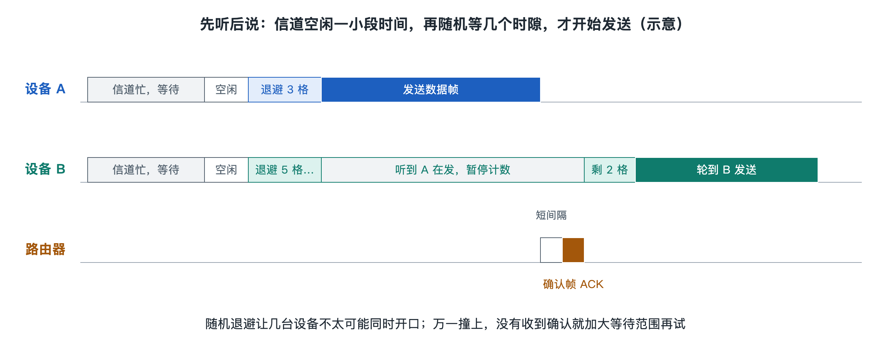

# 6.1 先听后说：CSMA/CA 与随机退避

晚上九点，客厅里电视在播 4K 视频，你的手机在刷短视频，孩子的平板在上网课，智能音箱正在下载更新。它们连的是同一台路由器、同一个信道。无线电波只有一条“空中通道”，同一时刻在同一信道上如果有两台设备同时发射，信号就会叠在一起，接收方往往一个也听不清。这些设备之间没有谁来点名分配话筒，靠的是每台设备都遵守同一套发言规矩：**先听后说，有人说话就等，等完再随机多等一会儿**。这套规矩就是 802.11 的核心接入方法 CSMA/CA。



## 6.1.1 一场没有主持人的圆桌讨论

不妨把一个信道想成一张圆桌，桌边的人都想发言，但没有主持人。有教养的人会这样做：

1. **先听**：开口前先确认此刻没人在说话；
2. **再等**：别人刚说完，不马上抢话，先停顿一小会儿；
3. **随机让一让**：如果好几个人都在等，每人心里各自随机数几下再开口，避免大家同时张嘴；
4. **确认被听到**：说完后看对方点头示意，没点头就当没听到，过一会儿再说一遍。

CSMA/CA 的全称是“载波侦听多路访问/冲突避免”（Carrier Sense Multiple Access with Collision Avoidance）。“载波侦听”对应第 1 步，“多路访问”说明大家共用一个介质，“冲突避免”对应第 2、3 步。第 4 步就是第三章讲过的确认帧（ACK）与重传机制。在标准中，这种基本接入方式叫“分布式协调功能”（Distributed Coordination Function，DCF），“分布式”指的正是没有中央调度者，每台设备独立按规则决策。

## 6.1.2 “听”：设备怎样判断信道忙闲

无线网卡判断信道是否空闲，叫“空闲信道评估”（Clear Channel Assessment，CCA），它有两种“耳朵”：

| 方式 | 怎么判断 | 特点 |
|---|---|---|
| 信号检测 | 识别出 Wi-Fi 帧开头的前导码 | 灵敏，能察觉很弱的 Wi-Fi 信号 |
| 能量检测 | 测量信道上的总能量是否超过门限 | 能发现非 Wi-Fi 干扰（如微波炉），但门限较高 |

除了真正去“听”，还有一种“虚拟侦听”。每个 Wi-Fi 帧里都有一个持续时间字段，告诉旁听者“这次对话还要占用多久”。其他设备读到后会设置一个倒计时，叫网络分配向量（Network Allocation Vector，NAV），倒计时没结束就视为信道忙，哪怕暂时听不到信号。下一节讲的 RTS/CTS 正是利用了这个机制。

## 6.1.3 “等”：帧间间隔与随机退避

信道一旦空闲，设备也不能立刻发送，而要先等一段固定的“帧间间隔”（Interframe Space，IFS）。不同间隔长度不同，等于给不同事务排了优先级：

- **短帧间间隔（SIFS）**：最短，用于一次对话内部的紧接动作，比如收到数据后回 ACK。在 5 GHz OFDM 物理层中为 16 微秒。因为最短，别人无法插进来打断一次完整的“发送—确认”。
- **DCF 帧间间隔（DIFS）**：更长，普通设备要开始一次新的发送，必须先等满它。

等满 DIFS 后，设备还要进入**随机退避**：在 0 到“竞争窗口”（Contention Window，CW）之间随机抽一个整数，作为要等待的时隙数。在常见的 OFDM 物理层里，一个时隙为 9 微秒，初始竞争窗口通常为 15。每过一个空闲时隙，计数器减一，减到零就发送。

关键细节在于：**倒数途中如果信道又忙了，计数器会暂停冻结，等信道再次空闲并过了 DIFS 后接着数，而不是重新抽号。** 这样，等得久的设备剩下的数字往往更小，下一轮更容易轮到它，体现了一种朴素的公平。

## 6.1.4 撞了怎么办：二进制指数退避

随机数再分散，也可能两台设备恰好抽到同一个数，同时发送，形成碰撞。问题是：无线设备发射时自己的信号远强于远处传来的信号，几乎无法“边说边听”，因此不能像早期有线以太网那样实时检测碰撞（CSMA/CD）。Wi-Fi 只能用间接办法判断：**发出数据后在规定时间内没收到 ACK，就认为失败。**

失败后，设备把竞争窗口大约翻倍（15→31→63……），上限通常为 1023，再重新抽号。这叫**二进制指数退避**。道理很直观：撞一次说明此刻想发言的人多，那就把选择范围放大，把大家错得更开。发送成功后，窗口恢复到初始值。重试次数达到上限仍失败，这一帧会被丢弃，交给上层协议处理。

一个简化的时间线示意：

```
信道忙 ──┐ 空闲 ├─ DIFS ─┤ 退避 3 个时隙 ├─ 发送数据 ─┤ SIFS ├─ ACK
```

## 6.1.5 规矩的代价与演进

先听后说让成百上千种设备在没有协调者的情况下相对有序地共享频谱，这是 Wi-Fi 能在免许可频段“自由生长”的基础。但它也有代价：每次发送前的间隔、退避和确认都要花时间，且这些时间不传用户数据；设备越多，碰撞概率越高，竞争窗口越拉越大，空闲的时隙也就越多。这正是你在拥挤的会议室里感觉“信号满格却很慢”的重要原因之一。

为了让视频通话、语音这类对延迟敏感的业务优先，802.11e 引入了增强型分布式信道接入（EDCA）：把流量分为语音、视频、尽力而为、背景四类，给高优先级的类别更短的等待间隔和更小的竞争窗口，相当于让它们“先举手”。

不过，“先听”有一个根本漏洞：如果两台设备彼此听不见，却都能被路由器听见，它们会同时认为信道空闲。这就是下一节要讨论的隐藏终端问题，以及 RTS/CTS 怎样借助 NAV 来补上这块短板。
