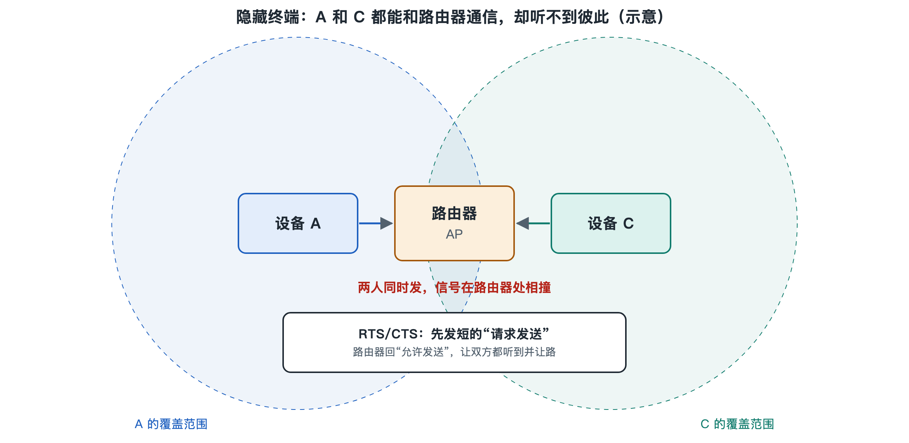

# 6.2 隐藏终端与 RTS/CTS

上一节讲了 CSMA/CA 的核心规矩：发送之前先听一听，信道空闲才说话，忙就退避等待。这套规矩有一个默认前提——所有设备都能互相“听见”。可是在真实的家里和办公室，这个前提并不总成立。本节就来看看当“听不见”发生时会出什么问题，以及 802.11 准备的补救办法。

## 6.2.1 一个三居室里的怪现象

设想这样的户型：路由器放在客厅中央，书房在客厅东侧，主卧在客厅西侧，书房和主卧之间隔着客厅外加两堵承重墙。书房里的笔记本电脑和主卧里的平板都能稳定连上路由器，信号格也都不差。

奇怪的是，每当两个人同时在线，比如一个在书房上传大文件，一个在主卧刷视频，两边都会觉得网络“一阵一阵地卡”。分开用时，各自都很顺畅。

这就是无线网络里经典的**隐藏终端问题**（Hidden Terminal Problem，也叫隐藏节点问题）。笔记本和平板都能听见路由器，却彼此听不见。在笔记本看来，平板是“隐藏”的；反过来也一样。

## 6.2.2 为什么“先听后说”会失灵

CSMA/CA 中的“载波侦听”，是由**发送方**在**自己的位置**判断信道忙不忙。问题在于，碰撞是否发生，取决于**接收方**那里的情况。

把过程拆开看：

1. 笔记本侦听信道，听不到平板的信号，判断“空闲”，开始向路由器发送一帧数据。
2. 几乎同时，平板也侦听信道，同样听不到笔记本，也判断“空闲”，开始发送。
3. 两路信号在路由器处叠加，路由器无法正确解出任何一帧，于是不回确认帧（ACK）。
4. 两台设备等不到 ACK，按退避规则重传，下一轮仍可能撞上。

可以用一个生活类比来理解：一间大会议室里，主持人坐在中间，两位发言人分别坐在长桌两端，彼此听不清对方，却都能被主持人听见。两人各自觉得“现在没人说话”，同时开口，主持人耳边只剩一片混响。

后果是重传增多、有效吞吐下降、延迟忽高忽低，这正是“一阵一阵地卡”的来源。信号格显示的是设备与路由器之间的信号强度，它反映不出两个终端互相听不见这件事，所以单看信号格往往找不到原因。

还有一个“镜像”问题叫**暴露终端**（Exposed Terminal）：某设备听到了邻近的另一次发送，于是不敢说话，可实际上它的目标接收方离那次发送很远，本来不会受干扰。隐藏终端导致“该等的没等”，暴露终端导致“不必等的白等”，两者都源于“发送方的侦听代替不了接收方的处境”。

## 6.2.3 RTS/CTS：先打招呼，再请广播“清场”

针对隐藏终端，802.11 标准定义了一种可选的握手机制：**RTS/CTS**。RTS 是“请求发送”（Request To Send），CTS 是“允许发送”（Clear To Send）。流程如下：

| 步骤 | 谁发 | 发什么 | 作用 |
|---|---|---|---|
| 1 | 想发数据的终端 | RTS（很短的控制帧） | 告诉接收方：我要发一段数据，预计占用多久 |
| 2 | 接收方（如路由器） | CTS（很短的控制帧） | 回复“可以发”，同时让周围所有能听见它的设备知道信道将被占用 |
| 3 | 发送终端 | 数据帧 | 正式传输 |
| 4 | 接收方 | ACK | 确认收妥 |

关键在第 2 步。笔记本发出的 RTS，平板可能听不见；但路由器回的 CTS，平板听得见，因为平板本来就能和路由器通信。RTS 和 CTS 帧里都带有一个“持续时间”字段，听到的设备会据此设置自己的**网络分配向量**（Network Allocation Vector，NAV），相当于一个倒计时：在倒计时结束前，即使自己侦听到信道空闲，也不主动发送。这被称为“虚拟载波侦听”，它和上一节讲的物理侦听配合使用。

回到会议室的类比：发言人先举手示意（RTS），主持人当众宣布“下面请东侧这位发言，大约两分钟”（CTS），西侧的人虽然听不到东侧，却听到了主持人的宣布，于是安静等待。

即使 RTS 本身也发生碰撞，损失也很小，因为 RTS 只有几十字节，撞掉了重来的代价远小于撞掉一个上千字节的数据帧。这就是这套机制的核心思路：**用小代价的“预约”去保护大代价的“传输”**。

## 6.2.4 代价与取舍：为什么它不是默认全开

RTS/CTS 并非没有成本。每发一帧数据，都要额外多出两次控制帧交换和相应的间隔等待。数据帧很短时，握手开销占比就很可观，反而降低效率。

因此在实践中，它通常与一个**RTS 阈值**（RTS Threshold）配合：只有数据帧长度超过阈值时才启用握手，短帧直接发。不少家用路由器后台的“高级无线设置”里能看到这一项，默认值往往设得接近最大帧长，等于基本关闭。是否调整、调成多少，不同厂商的默认和说明不尽相同，写作时普通家庭用户一般无需改动；只有在确认存在隐藏终端、且终端较多的场景下，才值得在测试对比后谨慎尝试。

此外，后续标准还发展出其他手段缓解这类问题：例如 Wi-Fi 6 引入的 OFDMA 和由接入点统一调度的上行传输（将在 6.5 节介绍），让接入点更多地“指挥”谁在何时发言，从结构上减少终端之间互相猜测的需要。

## 6.2.5 小结与过渡

隐藏终端问题揭示了共享无线介质的一条深层事实：**信道是否空闲，从来不是一个全局统一的答案，而是取决于站在哪里听**。CSMA/CA 只能让发送方在自己的位置做判断，RTS/CTS 则借助接收方的一次“广播”，把接收方那里的占用情况告诉周围设备。对于家庭用户，更直接的改善方式往往是调整路由器位置、增加 Mesh 节点或接入点，让终端之间、终端与接入点之间的“可听范围”更均衡。

解决了“谁什么时候说话”，下一个问题是“说话时用多快的语速”。下一节我们来看调制与编码，理解为什么离路由器越远，速率就越低。
