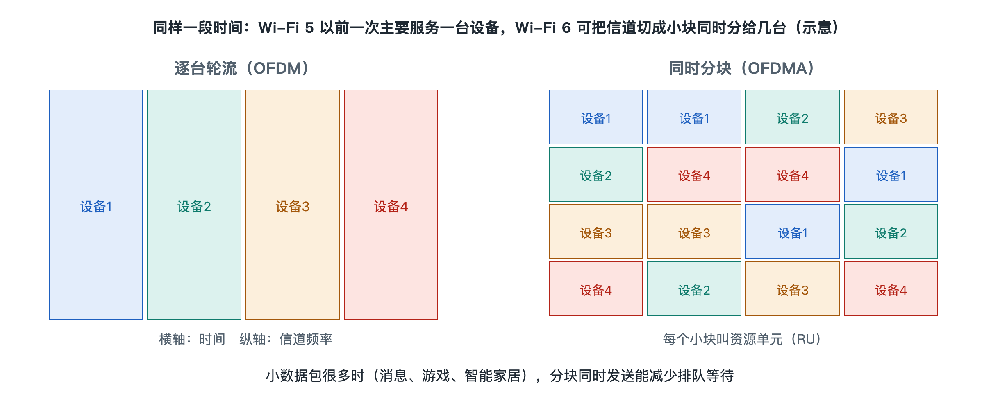

# 6.5 OFDMA 与目标唤醒时间：Wi-Fi 6 的调度思路

晚上八点，客厅里的路由器同时连着三部手机、一台平板、一个智能音箱、两个智能插座和一台扫地机器人。手机在刷短视频，音箱每隔一会儿上报一次状态，插座只发几十个字节的“我还在线”。前几节讲的“先听后说”在这种场景下显得笨拙：每次只能一台设备占用整个信道，哪怕它只说一句很短的话，信道也要为它停下来，还要付出抢占、等待和确认的开销。Wi-Fi 6（IEEE 802.11ax）给出的回答，是把“轮流说话”部分改成“分配座位、统一安排”。这一节讲其中两项核心手段：OFDMA 和目标唤醒时间。

## 6.5.1 从“包车”到“拼车”：OFDMA 是什么

第 6.3 节提到，Wi-Fi 使用 OFDM（正交频分复用，Orthogonal Frequency Division Multiplexing），把一个信道切成许多很窄的子载波并行传数据。在 Wi-Fi 5 及更早的版本中，除下行 MU-MIMO 这类空间上的共享外，一次传输的全部子载波通常都属于同一台设备，好比一辆大巴每趟只拉一位乘客，不管他行李多少。

OFDMA（正交频分多址，Orthogonal Frequency Division Multiple Access）的“多址”二字就是关键：同一次传输里的子载波可以分给不同设备。802.11ax 把若干相邻子载波编成一组，称为资源单元（RU，Resource Unit）。按标准规定，最小的 RU 含 26 个子载波，一个 20 MHz 信道最多可以同时切成 9 个这样的小 RU；也可以组合成 52、106、242 个子载波等更大的块。于是，路由器可以在同一时刻给手机一块大 RU 传视频，同时给音箱和插座各一块小 RU 传短消息。

| 对照项 | OFDM（Wi-Fi 5 及以前） | OFDMA（Wi-Fi 6 起） |
|---|---|---|
| 一次传输服务几台设备 | 一台 | 可以多台 |
| 小数据包的效率 | 低，整条信道为它让路 | 高，只占一小块频率 |
| 谁来安排 | 各设备自行竞争 | 接入点统一分配 |

为了让子载波切得更细、分配更灵活，802.11ax 还把子载波间隔从 312.5 kHz 缩小到 78.125 kHz，同样宽度的信道里子载波数变为原来的 4 倍，相应地每个符号的持续时间也拉长，有利于对抗多径带来的回声干扰（多径原理见第 8.2 节）。

## 6.5.2 上行也要排座位：触发帧

下行方向（路由器发给设备）好安排，因为数据都在路由器手里。难的是上行：几台设备要在同一时刻、各用各的 RU 发数据，必须在时间、频率和功率上对齐，否则彼此干扰。

Wi-Fi 6 的做法是由接入点发出一个触发帧（Trigger Frame），相当于发车前的点名单：写明哪台设备用哪块 RU、发多长、用什么调制编码。设备收到后在规定的极短间隔内一起发送。这一步意义很大：上行传输从“各自抢”变成了“按名单发”，在设备多、包又小的场合能明显减少碰撞和等待。需要说明的是，OFDMA 并没有取消 CSMA/CA，接入点自己仍要先竞争到信道，才能发出触发帧；它改变的是“抢到之后怎么用”。

## 6.5.3 约好时间再醒来：目标唤醒时间

OFDMA 解决的是“效率”，目标唤醒时间（TWT，Target Wake Time）解决的是“电量”和“秩序”。

传统的省电方式是设备定时醒来听信标帧（第 3.1 节），看看路由器有没有替它缓存数据。对一个靠电池工作的门窗传感器来说，频繁醒来听广播很耗电。TWT 让设备与接入点事先协商：“我每隔多久、在什么时刻醒来一次，每次醒多久。”约定之外的时间，设备可以把无线电完全关掉。

TWT 并非 Wi-Fi 6 首创，它最早出现在面向物联网的 802.11ah 中，802.11ax 将其引入主流 Wi-Fi。常见的两种形式：

- **单独 TWT**：某台设备与接入点一对一约定时间表；
- **广播 TWT**：接入点公布一套时间表，让一批设备分组按时醒来。

TWT 的好处不只在省电。接入点知道谁在什么时候醒，就能把不同设备错开，减少同一时刻争抢信道的人数，还能把醒来的设备直接编入触发帧，用 OFDMA 一次服务。两项技术因此互相配合：TWT 安排“什么时候来”，OFDMA 安排“来了坐哪儿”。

## 6.5.4 调度的代价与现实效果

把“自由竞争”部分改为“集中调度”，并非没有代价。接入点要掌握各设备的排队数据量，需要额外的报告和控制开销；调度算法写在芯片和固件里，标准只规定了工具，并未规定怎么分配最好，因此不同厂商产品的实际表现会有差异。此外，只有当路由器和终端都支持相应功能、并且确实开启时，效果才会出现；家里只有一两台设备、每台都在下载大文件时，OFDMA 的优势并不明显，它真正发挥作用的是设备多、小包多的场景，例如智能家居密集的住宅、会议室和教室。

回到客厅：Wi-Fi 6 没有让信道变宽，而是让同样的频率、同样的时间被安排得更满、更有秩序。这种“从竞争走向调度”的思路，在第七章的 Wi-Fi 6/6E 与 Wi-Fi 7 中会继续延伸，而它背后关于公平与效率的取舍，将在第 8.4 节溯源讨论。
