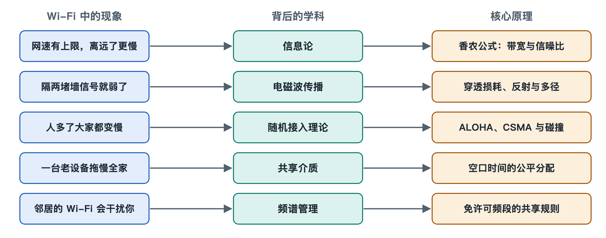

# 8.1 香农定理：带宽、信噪比与速率上限

打开手机的 Wi-Fi 详情页，有时能看到“链路速率”一栏：在路由器旁边，它可能显示几百甚至上千 Mbps；走到卫生间或阳台，数字可能掉到几十 Mbps。路由器没变，手机也没变，为什么速率会有这么大的差别？更进一步：每一代 Wi-Fi 都在提高速率，这种提高有没有尽头？回答这两个问题，要回到 1948 年。

## 8.1.1 一个公式划出的天花板

1948 年，美国贝尔实验室的克劳德·香农（Claude Shannon）发表论文《通信的数学理论》，给出了一个后来被称为**香农定理**（Shannon–Hartley theorem，也称香农公式）的结论。用文字表述就是：

> 在有噪声的信道里，可靠传输信息的最高速率（信道容量）＝ 带宽 × log₂（1 ＋ 信噪比）

其中三个量的含义如下：

| 量 | 中文解释 | 在 Wi-Fi 里对应什么 |
|---|---|---|
| 信道容量 C（Capacity） | 理论上能无差错传输的最高比特率 | 链路速率无论如何也越不过的上限 |
| 带宽 B（Bandwidth） | 信号占用的频率宽度，单位赫兹 | 20/40/80/160/320 MHz 信道宽度 |
| 信噪比 SNR（Signal-to-Noise Ratio） | 有用信号功率与噪声功率之比 | 信号强度减去底噪后的“余量” |

这个公式的分量在于：它不是某种设备的性能指标，而是对任何通信方式都成立的上限。工程师可以想办法逼近它，但无法超越它。可以把它想象成一条高速公路：带宽是车道数，信噪比决定每条车道上车能开多快、跟车能多紧密。

## 8.1.2 带宽：拓宽车道最“直接”

公式里带宽是乘在外面的，所以信道宽度翻倍，容量上限也近似翻倍。这正是 Wi-Fi 历代演进中最直观的一条线索：802.11a/g 用 20 MHz，Wi-Fi 4 引入 40 MHz，Wi-Fi 5 支持 80 和 160 MHz，Wi-Fi 7 进一步支持 320 MHz（只在 6 GHz 频段可用）。

但拓宽车道有代价。第一，频谱是有限的公共资源，2.4 GHz 频段总共只有约 80 MHz 可用，最多放下一条 40 MHz 信道，更宽的 80 MHz 以上信道无从谈起；第二，信道越宽，和邻居重叠的可能越大；第三，同样的发射功率摊到更宽的频带上，单位频率上的信号变弱，而噪声随带宽同比增加，信噪比会下降。所以“宽信道”在近距离、干扰少的环境里收益明显，在拥挤的公寓楼里未必划算。

## 8.1.3 信噪比：越清楚，每赫兹装得越多

信噪比在对数里面，影响方式完全不同。工程上常用分贝（dB）表示信噪比：10 dB 相当于信号是噪声的 10 倍，20 dB 是 100 倍，30 dB 是 1000 倍。代入公式可以得到一个好记的近似：**信噪比每提高约 3 dB（功率翻倍），每赫兹带宽大约多装 1 比特/秒**。

用一个粗算感受数量级：20 MHz 信道、信噪比 30 dB 时，log₂(1＋1000) 约等于 10，容量上限约为 20 MHz × 10 ≈ 200 Mbps。这是单条空间流的理论上限，实际速率还要扣除编码冗余、帧头和争用开销，通常明显低于它。

对数关系意味着“边际递减”：把信号功率加大十倍，换来的并不是十倍速率，而只是每赫兹多三比特左右。这也解释了为什么不能靠无限加大发射功率提速——何况各国监管对发射功率本来就有上限（见第 4.4 节）。

## 8.1.4 回到链路速率：调制编码是在“贴着天花板走”

第 6.3 节讲过，Wi-Fi 会根据信号好坏在多种调制编码方案（MCS）之间切换。站在香农定理的角度看，这就是在不同信噪比下，选一种尽量靠近容量上限、又不至于频繁出错的方案：

- 信噪比高（靠近路由器）：可以用 1024-QAM（Wi-Fi 6）甚至 4096-QAM（Wi-Fi 7），每个符号携带 10 或 12 比特；一般认为，1024-QAM 需要约 35 dB 的信噪比，4096-QAM 更要 40 dB 左右甚至更高，才能稳定工作。
- 信噪比低（隔两堵墙）：退回 BPSK、QPSK 这类每符号只带 1～2 比特的方案，并加大纠错冗余。

所以手机上跳动的“链路速率”，本质上是设备对当前信噪比的实时回应。离路由器远了，信号衰减、噪声不变，信噪比下降，天花板随之降低，设备只好降档。

## 8.1.5 多天线：香农定理没有被打破

MIMO 和多条空间流常被说成“突破了香农极限”，这是误解。香农公式描述的是一条信道；多天线利用多径环境在同一频率上建立了多条近似独立的空间信道，每条各自受香农公式约束，总容量大致随空间流数增加。这是“多修几层高架桥”，而不是让单条车道违反物理规律。同理，标准中写的峰值速率（如 Wi-Fi 7 按标准最多 8 个空间流算约 23 Gbps；常见的“46 Gbps”是按早期设想的 16 个空间流算的）都是在最宽信道、最高阶调制、最多空间流同时满足时的理论值，家庭环境几乎不会达到。

## 8.1.6 小结：三个旋钮

香农定理告诉我们，提高无线速率只有三个旋钮：更宽的带宽、更高的信噪比、更多的空间信道。Wi-Fi 的每一代演进，几乎都能归到这三者之一，再加上减少开销、让实际速率更贴近上限的努力。而信噪比的高低，很大程度上取决于电磁波在你家墙壁、家具之间怎样传播——这正是下一节要讨论的问题。
