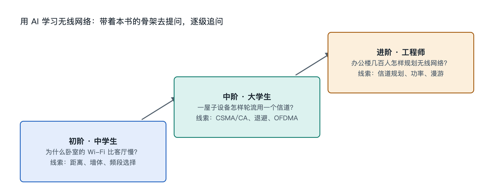

# 9.3 三阶提问阶梯：从中学生到工程师

同样一个问题——“为什么我卧室的 Wi-Fi 总是一格信号？”——一位初二学生、一位刚学完计算机网络课的大学生、一位负责门店网络的店长，想得到的答案并不一样。学生想知道“信号为什么会变弱”，大学生想弄清“路径损耗和墙体衰减怎么估算”，店长则需要“换什么设备、摆在哪里、怎么验证改好了”。把同一个问题直接丢给 AI，它往往会给出一个“平均水平”的回答：对学生太难，对工程人员又太浅。

本节提供一个工具：**三阶提问阶梯**。它把提问分成三个台阶，每一阶对应不同的知识深度和不同的输出期待。读者可以按自己的位置站上某一阶，也可以沿着台阶一级级往上走。

## 9.3.1 第一阶：现象与类比——“它是什么，像什么”

第一阶的目标是**建立直观图像**，适合中学生、普通读者，也适合任何人第一次接触某个新概念时使用。这一阶的提问有三个特点：从看得见的现象出发，要求用类比解释，明确说出自己的水平。

例如：

- “我是初中生。请用生活中的类比解释：为什么隔两堵墙之后手机的 Wi-Fi 信号会变弱？不要用公式。”
- “路由器设置里有 2.4 GHz 和 5 GHz 两个网络，它们有什么区别？请用‘道路’打比方说明。”
- “手机上 Wi-Fi 图标的格数代表什么？格数多就一定网速快吗？”

这一阶得到的回答，应能对应到本书第一章至第三章的内容：路由器、频段、信标帧、信号强度。判断 AI 回答好不好，有一个简单标准：**能不能用自己的话复述给家人听**。如果复述不出来，就追问“再简单一点”或“换一个类比”。

需要注意的是，类比只是帮助理解的拐杖。比如把 5 GHz 比作“更宽但更短的道路”大体可行，但“频率高所以穿墙差”这一说法需要更多前提才成立。在第一阶养成一个习惯：遇到类比时追问一句“这个比方在哪里不准确”。

## 9.3.2 第二阶：机制与原理——“它为什么这样工作”

第二阶的目标是**把现象落到机制和原理上**，适合大学生、通信与计算机专业入门者，以及想真正弄懂而不满足于类比的读者。这一阶的提问要点是：点名具体机制或标准名词，要求说明因果链条，请 AI 给出可以核对的依据。

同样从“卧室信号差”出发，第二阶的问题可以是：

- “请从电磁波传播的角度解释：信号穿过墙体时发生了哪些衰减？自由空间路径损耗与频率、距离是什么关系？”
- “信号强度下降后，802.11 设备为什么会自动降低速率？请结合调制编码方案（MCS）说明，并联系香农定理解释速率上限。”
- “请说明 CSMA/CA 的工作流程，以及为什么信号弱的设备会拖慢整个网络。”

这一阶对应本书第五章至第八章。提问时可以要求 AI 区分三类信息：**标准规定的内容**（如 IEEE 802.11 中的帧结构）、**物理规律**（如香农定理）、**厂商实现**（如某品牌路由器的智能选频）。这种区分能避免把某家厂商的功能误当成标准功能。对于 AI 给出的数字，例如某一 MCS 等级需要多少信噪比，要追问“这是典型值还是标准规定值、出自哪类资料”，并以标准文档或权威教材核对。

## 9.3.3 第三阶：设计与决策——“我该怎么做，怎么验证”

第三阶的目标是**把原理用于真实网络的设计、诊断和改进**，适合负责家庭、办公室或门店网络的职场人士，以及准备走向工程岗位的学生。这一阶的提问要提供实际条件，要求给出可比较的方案，并说明验证方法。

例如：

- “我家 120 平方米，三室两厅，光猫在客厅弱电箱，主卧隔两堵承重墙。现有一台双频路由器。请比较三种方案：增加有线回程的 AP、Mesh 无线回程、电力猫，列出各自的优缺点和适用条件。”
- “门店约 30 台设备同时在线，包括收银机、扫码枪和顾客手机。请给出频段规划和访客网络隔离的建议，并说明上线后该测哪些指标确认效果。”
- “这是我在 9.2 节画的信号地图数据（附表格），请指出最可能的问题点，并按‘先低成本、后高成本’的顺序给出排查步骤。”

第三阶的回答必须回到实物上检验。AI 给出的方案只是假设，真正的结论来自测量：改动前后在同一位置测信号强度和测速，记录对比。涉及安全配置时，提问应聚焦在防范上，例如“怎样确认我的路由器启用了 WPA3、固件是否最新”。

## 9.3.4 三阶对照与使用方法

| 阶梯 | 适合人群 | 提问关键词 | 期待输出 | 检验方式 |
|------|----------|-----------|---------|---------|
| 第一阶 现象与类比 | 中学生、普通读者 | “像什么”“为什么会这样” | 直观图像、类比 | 能否复述给别人听 |
| 第二阶 机制与原理 | 大学生、专业入门者 | 具体机制名、“因果链”“依据” | 机制流程、原理解释 | 与标准、教材核对 |
| 第三阶 设计与决策 | 网络负责人、工程方向学生 | 实际条件、“方案比较”“如何验证” | 可执行方案、验证指标 | 实测数据前后对比 |

使用这把阶梯，有三条实用建议：

1. **先自报位置**。在提问开头写明“我是中学生”或“我负责一家小门店的网络”，AI 会据此调整深度。
2. **一次只上一阶**。第一阶没弄懂就直接跳到第三阶，得到的方案往往看不懂，也无从判断对错。
3. **用本书目录当路线图**。从序章的认知骨架地图出发，每一章的概念都可以按三阶各问一遍，例如“隐藏终端”可以问“像什么”“RTS/CTS 怎么解决”“我的办公室是否存在这个问题、怎么测”。

## 9.3.5 小结：阶梯让提问变成学习

三阶提问阶梯的价值在于让读者对自己的问题有清楚的定位：先建立直观图像，再理解机制原理，最后落到真实网络的设计与验证。书提供骨架，路由器和手机提供实物，AI 负责按你所在的台阶继续展开，测量结果负责检验答案。下一节将回顾本章内容，并给出可以动手完成的探索任务。
